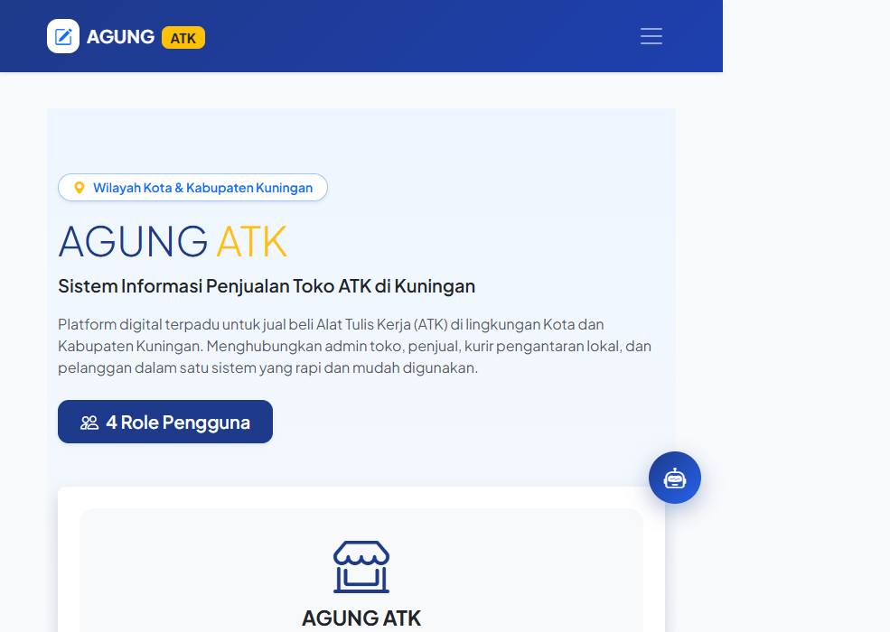
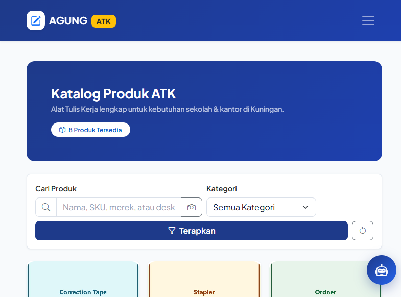
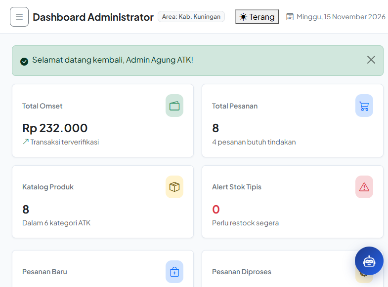
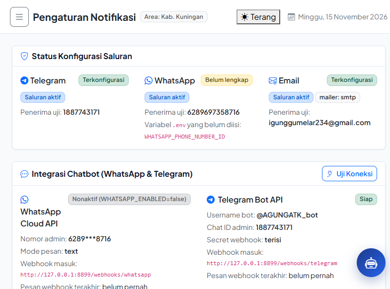
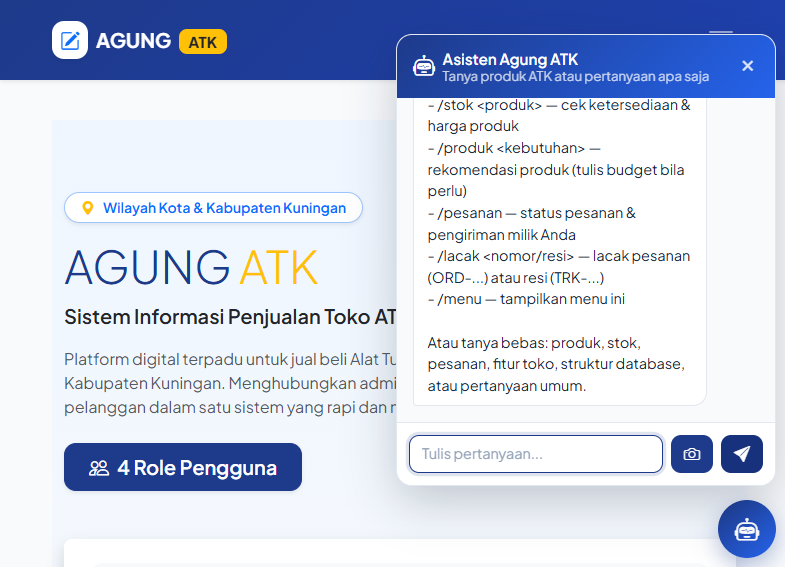

# Agung ATK — Sistem Informasi Penjualan ATK Kuningan

Aplikasi web penjualan Alat Tulis Kerja (ATK) berbasis **Laravel 13 / PHP 8.3** dengan
autentikasi & hak akses berbasis peran, katalog produk, keranjang & checkout, verifikasi
pembayaran, penugasan kurir, laporan, notifikasi **Telegram / WhatsApp / Email**,
AI Assistant, tema **Terang/Gelap/System**, serta **jejak audit aktivitas**.

Semua proses bisnis saling terhubung otomatis (lihat [Peta Otomasi Bisnis](#peta-otomasi-bisnis)),
sehingga aplikasi berjalan tanpa intervensi manual setelah prasyarat di bawah tersedia.

---

## Identitas Proyek

| | |
|---|---|
| Nama Mahasiswa | `[INDRA AGUNG GUMELAR]` |
| NIM | `[41257109]` |
| Kelompok | `[KELOMPOK]` |
| Tema Topik Kelompok | `[Sistem Informasi Berbasis Web untuk Pemberdayaan UMKM Cerdas]` |
| Mata Kuliah | Rekayasa Perangkat Lunak (TIKB2503021) — STMIK IKMI Cirebon |
| Repository | `[URL REPOSITORY GITHUB]` |

> Placeholder `[...]` sengaja belum diisi — jangan mengarang identitas/tautan.

### Tautan Video

| Video | Tautan |
|---|---|
| Video Progres 1 — PRD & Konsep (3–5 menit) | `[LINK VIDEO PROGRES 1]` |
| Video Progres 2 — UML & UI/UX (5–7 menit) | `[LINK VIDEO PROGRES 2]` |
| Video Final — Live Demo (8–12 menit) | `[LINK VIDEO FINAL]` |

Naskah siap rekam: [`docs/PANDUAN_VIDEO_PRESENTASI.md`](docs/PANDUAN_VIDEO_PRESENTASI.md).

---

## Ringkasan Proyek

**Deskripsi.** Aplikasi web penjualan Alat Tulis Kerja untuk toko di Kabupaten Kuningan:
katalog digital, keranjang–checkout–pesanan, verifikasi pembayaran, penugasan kurir,
laporan, notifikasi multi-kanal, serta integrasi AI (chatbot & pencarian gambar).

**Tujuan.**
1. Mengelola katalog, stok, dan transaksi ATK secara terintegrasi dan akurat.
2. Menegakkan hak akses ketat untuk empat peran dengan jejak audit.
3. Mengirim notifikasi otomatis (Telegram/WhatsApp/Email) pada kejadian bisnis.
4. Menjawab pertanyaan pengguna lewat **chatbot AI** yang memahami aplikasi & data toko
   (tanpa akses SQL bebas) dan **pencarian produk lewat foto** (computer vision).

**Teknologi.** PHP 8.3 · Laravel 13 · MySQL 8 · Blade + Bootstrap 5.3 · Queue database ·
Python + YOLOv8 (`ai-service/`) · PHPUnit.

**Fitur utama.** Autentikasi 4 role · katalog + barcode scan · keranjang/checkout bertransaksi ·
pembayaran & verifikasi · pengiriman berjenjang (admin→kurir) · laporan + ekspor/cetak ·
audit log · tema terang/gelap · halaman error ramah · backup database.

**Fitur AI (yang benar-benar diimplementasikan).**
- **Chatbot berlapis:** pagaran input (`ChatGuard`) → perintah lokal (`/menu`, `/stok`, `/pesanan`, `/lacak`, …) → **intent data read-only** diskop per role → provider LLM → pagaran output; identitas dari role session; jawaban fallback jujur bila API AI tidak tersedia; multi-bahasa.
- **Pencarian produk lewat foto:** deteksi objek **YOLOv8** (model dilatih sendiri, `ai-service/`) dengan fallback otomatis; hasil wajar: saran produk, "Barang Tidak Sesuai Kriteria Toko", atau "Stok Kosong".
- **Bukan** klaim: RAG, vector database, atau model berjalan lokal (lihat PRD §19.7).

**Aktor sistem.** Admin · Anggota (pegawai toko) · Kurir · Pelanggan · Tamu (katalog + chatbot dasar).

---

## Daftar Isi

1. [Cara Instalasi Awal](#1-cara-instalasi-awal)
2. [Cara Konfigurasi `.env`](#2-cara-konfigurasi-env)
3. [Cara Migrasi & Seeding Database](#3-cara-migrasi--seeding-database)
4. [Cara Menjalankan Aplikasi](#4-cara-menjalankan-aplikasi)
5. [Cara Mengaktifkan Scheduler & Queue Worker](#5-cara-mengaktifkan-scheduler--queue-worker)
6. [Cara Mengonfigurasi Notifikasi & AI](#6-cara-mengonfigurasi-notifikasi--ai)
7. [Cara Deployment agar Berjalan Terus](#7-cara-deployment-agar-berjalan-terus)
8. [Cara Memeriksa Log, Backup, & Memulihkan Aplikasi](#8-cara-memeriksa-log-backup--memulihkan-aplikasi)
9. [Peta Otomasi Bisnis](#peta-otomasi-bisnis)
10. [Hak Akses per Peran](#hak-akses-per-peran)
11. [Pengujian](#pengujian)
12. [Status Prasyarat (Kejujuran Operasional)](#status-prasyarat-kejujuran-operasional)
13. [Dokumentasi Proyek](#dokumentasi-proyek)
14. [Screenshot Aplikasi](#screenshot-aplikasi)

---

## Prasyarat

| Komponen | Versi |
|---|---|
| PHP | **8.3+** (ekstensi: pdo_mysql/sqlite, mbstring, openssl, tokenizer, fileinfo, curl, zip) |
| Composer | 2.x |
| Database | MySQL 8 / MariaDB 10.4+ (**atau** SQLite untuk pengembangan) |
| Node.js & npm | 18+ (hanya untuk build aset Vite) |
| Server | Apache/Nginx (produksi) atau `php artisan serve` (pengembangan) |

---

## 1. Cara Instalasi Awal

```bash
git clone <repo-url> agungatkopencode
cd agungatkopencode

# Opsi A — setup otomatis (install + .env + key + migrate + build aset)
composer run setup

# Opsi B — manual
composer install
cp .env.example .env          # lalu isi .env (lihat bagian 2)
php artisan key:generate
npm install
npm run build                 # hasil build ada di public/build
```

Setelah itu lanjut ke [bagian 3](#3-cara-migrasi--seeding-database) untuk migrasi & seed.

> **Catatan Windows/Laragon:** arahkan virtual host atau jalankan
> `php artisan serve --port=8000` dari folder proyek.

---

## 2. Cara Konfigurasi `.env`

Salin `.env.example` → `.env` (file `.env` **tidak boleh** masuk git; sudah ada di `.gitignore`).
`.env.example` berisi seluruh kunci dengan nilai kosong/placeholder — **tanpa rahasia asli**.

| Kelompok Kunci | Fungsi | Contoh isi (produksi) |
|---|---|---|
| `APP_ENV`, `APP_DEBUG`, `APP_URL` | Lingkungan & URL | `production`, `false`, `https://toko.example` |
| `DB_*` | Database (`mysql`) | host/port/nama db/user/password |
| `SESSION_DRIVER` | Sesi | `database` (sudah bawaan) |
| `QUEUE_CONNECTION` | Antrean | `database` (sudah bawaan) |
| `CACHE_STORE` | Cache | `database` (sudah bawaan) |
| `LOG_CHANNEL`, `LOG_LEVEL`, `LOG_DAILY_DAYS` | Log rotasi harian | `daily`, `info`, `14` |
| `MAIL_*` | Email (SMTP) | host/port/username/password pengirim |
| `TELEGRAM_BOT_TOKEN`, `TELEGRAM_ADMIN_CHAT_ID` | Telegram | token BotFather + chat ID |
| `WHATSAPP_*` | WhatsApp Cloud API | access token, phone number ID |
| `NOTIFICATIONS_ENABLED/MOCK/QUEUE` | Saklar notifikasi | `true` / `false` / `true` |
| `AI_API_KEY`, `AI_URL`, `AI_MODEL` | AI Assistant | kunci API (kosongkan = mode fallback lokal) |
| `SEED_PASSWORD` | Password akun hasil seeder | **wajib diisi** agar akun dev dibuat |

Checklist produksi ada di bagian akhir `.env.example` (hapus tanda `#` saat go-live).
Kunci API/hanya diisi **setelah** `.env` terbentuk — jangan pernah menaruhnya di `.env.example`.

**Cek cepat:** `php artisan config:show app.env` · `php artisan config:show database.default`

---

## 3. Cara Migrasi & Seeding Database

```bash
# Buat database MySQL dulu, lalu sesuaikan DB_* di .env
php artisan migrate              # 25 migration (roles, users, produk, pesanan, audit, notifikasi, kanal, dst.)
php artisan db:seed              # seluruh seeder (RoleSeeder, UserSeeder, produk, pesanan contoh)
```

Seeder **aman dijalankan berulang** (updateOrCreate/idempoten) dan **tidak menghapus data**.

* `RoleSeeder` — 4 peran kanonik: `admin`, `anggota`, `kurir`, `pelanggan`
  (nama lama `penjual`/`seller`/`courier`/`customer` dimigrasikan, bukan diduplikasi).
* `UserSeeder` — akun dev **hanya dibuat bila `SEED_PASSWORD` diisi**; nomor pegawai
  unik `AGT-0001` (anggota) & `KUR-0001` (kurir) dibuat otomatis.
* Migrasi data (`rename_penjual_role_to_anggota`, field pegawai, tabel `activity_logs`)
  tidak menghapus akun/riwayat apa pun.

**Login awal (dev)** — gunakan email di bawah + password = isi `SEED_PASSWORD`:

| Peran | Email | Setelah login |
|---|---|---|
| Admin | `admin@agungatk.com` | `/admin/dashboard` |
| Anggota | `penjual@agungatk.com` | `/anggota/dashboard` |
| Kurir | `kurir@agungatk.com` | `/kurir/dashboard` |
| Pelanggan | `pelanggan@agungatk.com` | `/pelanggan/dashboard` |

Registrasi publik selalu menghasilkan peran **pelanggan** (ditentukan backend, bukan input form).

---

## 4. Cara Menjalankan Aplikasi

### Pengembangan (semua proses dalam satu perintah)

```bash
composer run dev
```

Perintah ini menjalankan `php artisan dev` → **server + queue worker + Vite** sekaligus,
sehingga notifikasi terkirim dan fitur otomatis langsung berfungsi tanpa membuka banyak terminal.

### Manual (bila diperlukan)

```bash
php artisan serve                 # http://127.0.0.1:8000
php artisan queue:work            # worker notifikasi (terminal terpisah)
php artisan schedule:run          # scheduler (bisa via cron — lihat bagian 5)
npm run dev                       # aset Vite saat mengubah blade/CSS
```

### Setelah mengubah kode

```bash
php artisan view:clear            # bila tampilan tampak lama
npm run build                     # bila ada perubahan aset
```

Uji kesehatan: `GET /up` (200 = aplikasi hidup), `php artisan about`.

---

## 5. Cara Mengaktifkan Scheduler & Queue Worker

Keduanya **wajib aktif di produksi** agar fitur otomatis (ringkasan harian, pengiriman
notifikasi) benar-benar berjalan. Tanpa queue worker, notifikasi berstatus *pending*
di tabel `notification_logs` dan **tidak terkirim**.

### Tugas terjadwal yang tersedia (`routes/console.php`)

| Waktu (Asia/Jakarta) | Perintah | Fungsi |
|---|---|---|
| 07:00 | `notifications:daily-summary` | Ringkasan penjualan harian → admin |
| 02:00 | `queue:prune-failed --hours=720` | Bersihkan job gagal > 30 hari |
| 02:15 | `queue:prune-batches --hours=720` | Bersihkan batch queue > 30 hari |

Semua sudah `withoutOverlapping()` dan menulis output ke `storage/logs/scheduler.log`.
Verifikasi: `php artisan schedule:list`.

### Mengaktifkan — pilih **SATU** cara

**A. Cron (paling umum di shared hosting/Linux)** — `crontab -e` (user web, mis. `www-data`):

```cron
* * * * * cd /var/www/agungatkopencode && php artisan schedule:run >> /dev/null 2>&1
```

Contoh siap pakai: [`deploy/crontab.example`](deploy/crontab.example).

**B. Supervisor (queue worker + scheduler proses panjang):**

Salin [`deploy/supervisor/agung-atk-worker.conf`](deploy/supervisor/agung-atk-worker.conf) dan
[`deploy/supervisor/agung-atk-scheduler.conf`](deploy/supervisor/agung-atk-scheduler.conf)
ke `/etc/supervisor/conf.d/`, lalu:

```bash
sudo supervisorctl reread && sudo supervisorctl update
sudo supervisorctl status
```

**C. systemd (Debian/Ubuntu/RHEL):**

[`deploy/systemd/agung-atk-worker.service`](deploy/systemd/agung-atk-worker.service) &
[`deploy/systemd/agung-atk-scheduler.service`](deploy/systemd/agung-atk-scheduler.service):

```bash
sudo systemctl daemon-reload
sudo systemctl enable --now agung-atk-worker agung-atk-scheduler
```

**D. Panel hosting** (Plesk/cPanel): jalankan perintah berikut sebagai *scheduled task*
harian (bila cron per-menit tidak tersedia) — daftarkan ketiganya:

```bash
php artisan notifications:daily-summary
php artisan queue:prune-failed --hours=720
php artisan queue:prune-batches --hours=720
```

### Queue worker

* Perintah produksi: `php artisan queue:work database --tries=3 --max-time=3600 --sleep=3`
  (`--max-time` membuat worker restart tiap jam → memori bersih otomatis).
* Job notifikasi (`SendNotificationJob`) punya **retry 3× dengan backoff**;
  kegagalan tercatat di tabel `failed_jobs` → lihat/ulangi dengan
  `php artisan queue:failed` dan `php artisan queue:retry all`.
* Setelah deploy kode baru: `php artisan queue:restart` (worker lama berhenti
  setelah job selesai, supervisor/systemd menyalakan yang baru).
* Cek antrean: `php artisan queue:monitor database:notifications,default`.

---

## 6. Cara Mengonfigurasi Notifikasi & AI

### Notifikasi (Telegram / WhatsApp / Email)

Tiga saluran **terisolasi**: kegagalan satu saluran tidak membatalkan transaksi dan
tidak menghentikan saluran lain (setiap saluran punya catatan & job sendiri di antrean).

| Variabel | Keterangan |
|---|---|
| `NOTIFICATIONS_ENABLED` | `false` = matikan seluruh notifikasi |
| `NOTIFICATIONS_MOCK` | `true` = tanpa panggilan API luar (demo/pengujian) |
| `NOTIFICATIONS_QUEUE` | `true` = kirim lewat antrean (**butuh `queue:work`**) |
| `NOTIFICATION_ADMIN_EMAIL` | Penerima email ringkasan admin |
| `MAIL_MAILER` | `smtp` untuk pengiriman nyata (bawaan `log` = ditulis ke log) |
| `TELEGRAM_BOT_TOKEN`, `TELEGRAM_ADMIN_CHAT_ID` | Dapatkan **Chat ID dari `getUpdates`**, bukan dari nomor telepon (panduan di menu **Notifikasi** admin) |
| `WHATSAPP_ACCESS_TOKEN`, `WHATSAPP_PHONE_NUMBER_ID`, `WHATSAPP_MESSAGE_MODE` | WhatsApp Business Cloud API; mode `template` butuh template yang disetujui Meta |

Verifikasi dari aplikasi: **menu Notifikasi (admin)** → status tiap saluran
(*configured/belum dikonfigurasi*), saklar per-kejadian (18 kejadian), dan tombol
**uji kirim** (dibatasi 5/menit). Riwayat pengiriman ada di tabel `notification_logs`.

Bila sebuah saluran **belum dikonfigurasi**, sistem **melewati saluran itu dengan halus**
(menampilkan status "belum dikonfigurasi"), bukan error.

### AI Assistant

| Variabel | Keterangan |
|---|---|
| `AI_API_KEY` | Kunci API (OpenAI-compatible). **Kosongkan = mode fallback lokal** |
| `AI_URL` | Endpoint chat completions |
| `AI_MODEL` | Nama model |
| `AI_TIMEOUT` | Timeout detik (default 20) |

Bila kunci kosong, API error, atau timeout → balasan dihasilkan **lokal dari data
database** (produk nyata, bukan karangan) dan kegagalan dicatat ke log
(`AIService: ...`) **tanpa membocorkan kunci API**. Halaman utama tidak pernah rusak
karena AI. Chat beranda dibatasi `throttle:20/menit/IP`.

---

## 7. Cara Deployment agar Berjalan Terus

> Aplikasi hanya "aktif selama **server + database + scheduler + queue worker** tersedia".
> Jangan mengklaim sebaliknya — lihat [Status Prasyarat](#status-prasyarat-kejujuran-operasional).

### Langkah go-live

```bash
# 1. Ambil kode di server
git clone <repo-url> /var/www/agungatkopencode && cd /var/www/agungatkopencode

# 2. Environment
cp .env.example .env
php artisan key:generate
#    -> edit .env: APP_ENV=production, APP_DEBUG=false, APP_URL, DB_*, MAIL_*, TELEGRAM_*, AI_*

# 3. Dependensi & aset
composer install --no-dev --optimize-autoloader
npm ci && npm run build

# 4. Database (MIGRASI — jalankan manual & dengan backup; jangan otomatis saat deploy)
php artisan migrate --force          # HANYA setelah backup (bagian 8)
php artisan db:seed --force          # OPSIONAL — lewati bila data produksi sudah ada

# 5. Storage & cache
php artisan storage:link             # gambar produk (disk public)
php artisan optimize                 # config/route/view cache
php artisan event:cache              # bila tersedia (opsional)

# 6. Hak akses folder web
#    -arahkan docroot ke /public
#    -storage/, bootstrap/cache/ writable oleh user web (www-data)
```

### Proses yang harus terus berjalan

| Proses | Perintah | Pengelola |
|---|---|---|
| Web server | nginx/apache + php-fpm | systemd/bawaan OS |
| Queue worker | `queue:work ...` | [Supervisor](deploy/supervisor/agung-atk-worker.conf) / [systemd](deploy/systemd/agung-atk-worker.service) |
| Scheduler | `schedule:run` tiap menit **atau** `schedule:work` | [cron](deploy/crontab.example) / Supervisor / systemd |

### Prosedur deploy selanjutnya

```bash
php artisan down --retry=30
git pull
composer install --no-dev --optimize-autoloader
npm ci && npm run build
php artisan migrate --force        # hanya bila ada migration baru — SETELAH backup
php artisan optimize
php artisan queue:restart
php artisan up
```

### Keamanan produksi

* `APP_DEBUG=false`, `LOG_LEVEL=info`.
* HTTPS + `SESSION_SECURE_COOKIE=true`.
* `.env`, `storage/`, `database/*.sqlite` tidak boleh publik.
* Password dev hasil seeder diganti; buat admin baru via seeding/fitur admin.
* Halaman error ramah tersedia: `resources/views/errors/` (404, 403, 419, 429, 500)
  — tidak menampilkan detail teknis ke pengguna.

---

## 8. Cara Memeriksa Log, Backup, & Memulihkan Aplikasi

### Memeriksa log

| Sumber | Lokasi / Perintah | Isi |
|---|---|---|
| Log aplikasi (rotasi harian, 14 hari) | `storage/logs/laravel-YYYY-MM-DD.log` | error, warning (AI, dsb.) |
| Tail langsung | `php artisan pail` | streaming log terkini |
| Scheduler | `storage/logs/scheduler.log` | hasil tugas terjadwal |
| Queue worker | `storage/logs/worker.log` | output worker (bila pakai Supervisor) |
| Job gagal | `php artisan queue:failed` → `queue:retry <id>` | retry terbatas sudah jalan otomatis |
| Audit aktivitas pengguna | menu **Audit Log** (admin) / tabel `activity_logs` | siapa, peran, apa, kapan |
| Riwayat notifikasi | menu **Notifikasi** (admin) / tabel `notification_logs` | status per saluran + pesan error aman |

Catatan keamanan log: ringkasan audit & log **tidak pernah memuat kata sandi/token**;
kunci API tidak ikut tercatat (hanya status/kode error).

### Backup

```bash
# Linux (cron harian mis. pukul 01:00)
./scripts/backup-database.sh /path/off-site-backup

# Windows / Laragon
powershell -ExecutionPolicy Bypass -File scripts\backup-database.ps1 -Destination D:\backups
```

Backup **wajib** mencakup 4 bagian:

1. Database — hasil `scripts/backup-database.*` (`.sql.gz`)
2. `.env` (rahasia) — simpan terenkripsi/terpisah
3. `storage/app/public/` (gambar produk)
4. `storage/app/private/` (bukti pembayaran — **tidak boleh publik**)

> Folder `storage/backups/` sudah masuk `.gitignore`. Pindahkan hasil backup ke
> lokasi **terpisah dari server** (off-site/cloud), dan uji restore berkala.

### Memulihkan (recovery)

```bash
# MySQL
mysql -u <user> -p <database> < backup.sql
# atau dari file terkompresi
gunzip -c backup_20261017_070000.sql.gz | mysql -u <user> -p <database>

# SQLite
cp backup.sqlite database/database.sqlite

# Kembalikan folder aset & .env, lalu:
php artisan migrate:status        # pastikan semua migration jalan
php artisan optimize:clear
php artisan queue:restart
```

Checklist pemulihan: restore DB → restore `storage/` + `.env` → `php artisan optimize:clear`
→ `php artisan queue:restart` → uji `GET /up` dan login tiap peran.

---

## Peta Otomasi Bisnis

Alur yang berjalan **otomatis** tanpa intervensi manual:

```
Keranjang → Checkout ──[transaksi DB, lock baris produk]──► Pesanan PENDING
      │  • stok DIKURANGI SEKALI di sini (lockForUpdate, anti-stok-negatif)
      │  • proteksi klik ganda (cache lock per pengguna)
      │  • audit: order.created
      ▼
Unggah bukti → Admin VERIFIKASI ──► pesanan PAID (transaksi DB, audit: payment.verified)
      │                              penolakan → payment.rejected (+alasan, audit)
      ▼
Anggota: PAID → PROCESSING → READY_TO_SHIP (audit: order.processing/ready_to_ship)
      ▼
Admin menugaskan kurir (SHIPMENT waiting, audit: shipment.assigned)
      ▼
Kurir: waiting → picked_up → shipping → delivered  (status pesanan ikut sinkron;
      audit: shipment.status_updated; notifikasi pelanggan per tahap)
      ▼
Admin: DELIVERED → COMPLETED (audit: order.completed) → masuk riwayat & laporan

PEMBATALAN (admin: pending/paid/processing/ready_to_ship; pelanggan: pending saja)
      │  • stok DIKEMBALIKAN SEKALI dalam transaksi (OrderCancellationService,
      │    kunci baris → anti double-restore)
      │  • pembayaran pending otomatis ditolak
      │  • audit: order.cancelled + notifikasi order.cancelled
      ▼
Stok menyentuh batas minimum (setelah checkout/perubahan stok) → peringatan stok
      + notifikasi (stock.low / stock.out) bila saluran aktif

Setiap aktivitas penting → audit log (activity_logs): siapa, peran saat itu,
jenis aktivitas, objek terkait, waktu, ringkasan aman.

Terdokumentasi: 07:00 WIB → ringkasan penjualan harian ke admin (scheduler).
```

**Kebijakan stok (tunggal & jelas):**

* **Dikurangi:** hanya saat checkout dibuat (sekali, dalam transaksi terkunci).
* **Dikembalikan:** hanya saat pesanan dibatalkan (sekali, dengan kunci baris).
* **Tidak diubah:** saat verifikasi bayar, pengiriman, maupun pesanan selesai.
* **Penyesuaian manual:** form stok admin/anggota (wajib alasan untuk anggota,
  tercatat di audit).

---

## Hak Akses per Peran

| Peran | Route prefix | Akses inti |
|---|---|---|
| **admin** | `/admin/*` | Dashboard, produk, kategori, pengguna/pegawai, pembayaran, pengiriman, laporan, notifikasi, **audit log** |
| **anggota** | `/anggota/*` | Antrean pesanan (proses/siap kirim), peringatan & **form stok (dengan alasan)**, aktivitas sendiri, profil |
| **kurir** | `/courier/*` | Hanya pengiriman miliknya sendiri, perbarui status, profil |
| **pelanggan** | `/dashboard`, `/orders`, `/cart`… | Pesanan, keranjang, pembayaran, alamat, AI, review, profil **milik sendiri** |

Ditegakkan **di server** oleh middleware (`admin`, `anggota`, `courier`, `customer`,
`EnsureAccountIsActive`) pada seluruh route termasuk AJAX — URL yang salah selalu
ditolak backend (403/404), bukan sekadar disembunyikan dari menu. Navigasi sidebar
berbeda per role (tanpa menu ganda); layout bersama dipakai ulang.

---

## Pengujian

```bash
php artisan view:clear && php artisan test --compact   # seluruh suite (PHPUnit)
vendor/bin/pint --dirty --format agent                 # format kode setelah edit PHP
```

Hasil verifikasi terakhir:

* **PHPUnit: 645/645 tes lulus (3.050 asersi)** — 18 November 2026 (`php artisan test --compact`),
  mencakup otomasi stok, pembatalan anti-double-restore, proteksi checkout ganda, audit bisnis,
  halaman error, seluruh chatbot (identitas/perintah/intent data/webhook), notifikasi, dan pencarian gambar YOLO.
* **E2E audit (server hidup): 115/115 cek lulus, 0 broken link** — crawl semua halaman
  untuk 4 peran + tamu, marker error, RBAC 403, halaman 404 ramah, kartu pembatalan.
* **Pint:** `vendor/bin/pint --test` lolos seluruh repo · **Nama route:** 0 duplikat.

Cakupan otomasi/hak akses mencakup antara lain: checkout mengurangi stok sekali,
pembatalan mengembalikan stok tepat sekali (anti dobel), proteksi checkout ganda,
verifikasi bayar & aksi kurir tercatat di audit, halaman error ramah (404/403/500),
redirect login per peran, pembatasan role per route, dan regresi fitur lama
(notifikasi, tema, katalog, pembayaran, pengiriman, laporan).

---

## Status Prasyarat (Kejujuran Operasional)

Agar tidak menyesatkan — komponen yang **belum tentu aktif** di lingkungan Anda:

1. **Server web, database, scheduler, dan queue worker harus berjalan.**
   Tanpa server → aplikasi tidak bisa diakses; tanpa DB → hanya halaman error yang tampil;
   tanpa scheduler → ringkasan harian/pruning tidak jalan; tanpa queue worker →
   notifikasi berstatus *pending* dan tidak terkirim.
2. **Telegram/WhatsApp** baru terkirim bila token & chat ID diisi dan
   `NOTIFICATIONS_MOCK=false`. Selama kredensial kosong, saluran dilaporkan
   *belum dikonfigurasi* dan dilewati tanpa mengganggu proses bisnis.
3. **Email** bawaan `MAIL_MAILER=log` (hanya ditulis ke log). Pengiriman nyata
   memerlukan kredensial SMTP di `.env`.
4. **AI Assistant** memerlukan `AI_API_KEY`; tanpa kunci/ saat API gagal, sistem
   memakai jawaban fallback lokal (tetap berfungsi, tidak error).
5. **Backup** tersedia sebagai script manual — **belum** dijadwalkan otomatis.
   Daftarkan via cron bila diperlukan.
6. **Backup & migrasi produksi** tidak dijalankan otomatis di deployment —
   selalu manual + persetujuan (aturan: jangan menjalankan migrasi destruktif
   atau menghapus data produksi tanpa izin).

### Status Integrasi Terkini (jujur — 17 November 2026)

| Integrasi | Status | Keterangan |
|---|---|---|
| Email (SMTP) | ✅ Teruji nyata | Uji kirim dari halaman admin → diterima Mailpit |
| Telegram — pengiriman | ✅ Teruji nyata | `getMe` sukses: bot `AGUNGATK_bot` |
| Telegram — webhook masuk | ⏸️ Menunggu | Keputusan username bot + URL HTTPS publik |
| WhatsApp Cloud API | ⏸️ Menunggu | Mekanisme lengkap teruji mock; kredensial Meta diperlukan |
| Chatbot mode API (LLM) | ⏸️ Menunggu | Kunci saat ini ditolak 401 → mode lokal aktif & teruji |
| YOLOv8 (pencarian gambar) | ✅ Aktif | `ai-service/server.py` port 8090, model terlatih |
| GitHub Actions | ⏸️ Menunggu push | Workflow siap di `.github/workflows/ci.yml` |

---

## Dokumentasi Proyek

| Dokumen | Isi |
|---|---|
| [`docs/AUDIT_PROYEK_AGUNG_ATK.md`](docs/AUDIT_PROYEK_AGUNG_ATK.md) | Audit menyeluruh + pemetaan rubrik OBE |
| [`docs/PRD_SRS_AGUNG_ATK.md`](docs/PRD_SRS_AGUNG_ATK.md) | PRD/SRS 20 bagian (IEEE 830), user story + acceptance criteria |
| [`docs/SDD_ARSITEKTUR_AGUNG_ATK.md`](docs/SDD_ARSITEKTUR_AGUNG_ATK.md) | Arsitektur, audit UI/UX, keterkaitan diagram↔kode |
| [`docs/uml/`](docs/uml/) | Use Case, Activity, Class, Sequence, ERD (Mermaid) |
| [`docs/prototype/index.html`](docs/prototype/index.html) | Prototype interaktif (buka langsung di browser) |
| [`docs/TESTING_CI_CD_AGUNG_ATK.md`](docs/TESTING_CI_CD_AGUNG_ATK.md) | Strategi tes + pipeline GitHub Actions |
| [`docs/PANDUAN_VIDEO_PRESENTASI.md`](docs/PANDUAN_VIDEO_PRESENTASI.md) | Naskah 3 video + rubrik khusus video |
| [`docs/LAPORAN_AKHIR_AGUNG_ATK.md`](docs/LAPORAN_AKHIR_AGUNG_ATK.md) | Laporan akhir akademik |
| [`docs/EVALUASI_RUBRIK_OBE_AGUNG_ATK.md`](docs/EVALUASI_RUBRIK_OBE_AGUNG_ATK.md) | Penilaian mandiri rubrik OBE |
| [`docs/CHATBOT_SYSTEM_KNOWLEDGE.md`](docs/CHATBOT_SYSTEM_KNOWLEDGE.md) | Basis pengetahuan chatbot |
| [`docs/CHATBOT_WHATSAPP_TELEGRAM_SETUP.md`](docs/CHATBOT_WHATSAPP_TELEGRAM_SETUP.md) | Panduan konfigurasi webhook kanal |
| [`docs/NOTIFICATION_INTEGRATION.md`](docs/NOTIFICATION_INTEGRATION.md) | Pusat integrasi notifikasi: kanal, kejadian per peran, status uji nyata |
| [`docs/WHATSAPP_SETUP.md`](docs/WHATSAPP_SETUP.md) | Panduan WhatsApp Cloud API |
| [`docs/TELEGRAM_SETUP.md`](docs/TELEGRAM_SETUP.md) | Panduan Telegram Bot API + webhook dua arah |
| [`docs/GMAIL_SETUP.md`](docs/GMAIL_SETUP.md) | Panduan email Gmail (App Password SMTP) |
| [`docs/CHATBOT_DATABASE_KNOWLEDGE.md`](docs/CHATBOT_DATABASE_KNOWLEDGE.md) | Struktur database untuk chatbot + pembaruan pengetahuan |
| [`docs/CHATBOT_SECURITY.md`](docs/CHATBOT_SECURITY.md) | Pagar keamanan & privasi chatbot |
| [`docs/CHATBOT_USER_IDENTITY.md`](docs/CHATBOT_USER_IDENTITY.md) | Identitas pengguna login & pencarian akun pelanggan per role |

---

## Screenshot Aplikasi

Diambil langsung dari aplikasi yang berjalan (17 November 2026):

| | |
|---|---|
| **Beranda (publik + widget chatbot)** |  |
| **Katalog & pencarian gambar** |  |
| **Dashboard Administrator** |  |
| **Pengaturan notifikasi (status saluran jujur)** |  |
| **Chatbot — perintah `/menu`** |  |

---

## Struktur Singkat

```
app/Http/Middleware/      admin, anggota, courier, customer, EnsureAccountIsActive, SecurityHeaders
app/Http/Controllers/     Admin/ Anggota/ Auth/ Courier/ Seller/ + utama (checkout, orders, AI, webhook)
app/Services/             OrderCancellationService, Notifications/ (5 saluran+kejadian), Channels/
app/Jobs/                 SendChannelReplyJob (balasan chatbot via kanal, retry 3x)
app/Models/               Order, Payment, Shipment, Product, User, ActivityLog, ChannelIdentity, ...
app/Support/              AIService, ChatGuard, ChatbotDataService, ChatbotProfile,
                          DatabaseKnowledgeService, WorkflowKnowledge, CartSession, ShipmentStatus
database/migrations/      25 migration (termasuk role, audit, notifikasi, kanal chatbot)
resources/views/          layouts, admin/, anggota/, courier/, errors/ (halaman error ramah)
routes/web.php            111 route (publik + per peran)
routes/console.php        scheduler (ringkasan harian + pruning)
ai-service/               layanan Python YOLOv8 (server.py, train.py, model terlatih)
docs/                     PRD/SRS, SDD+UML, audit, testing/CI-CD, panduan video, laporan akhir
deploy/                   contoh Supervisor, systemd, crontab untuk produksi
scripts/                  backup database (bash + PowerShell)
tests/                    41 file — 645 tes fitur & unit
.github/workflows/        ci.yml (PHPUnit + Pint + build Vite)
```

---

## Lisensi

Proyek aplikasi (bukan kerangka Laravel). Laravel adalah framework berlisensi MIT.
