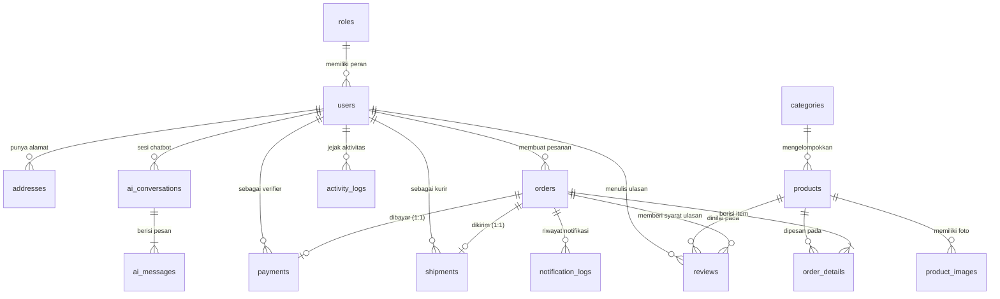

# Pengetahuan Database untuk Chatbot — Agung ATK

Dokumentasi ini adalah **sumber kebenaran terdokumentasi** untuk chatbot AI Agung ATK
(bagian C dari spesifikasi chatbot). Seluruh isi dihasilkan dari pemeriksaan nyata:

| Sumber | Status verifikasi |
|---|---|
| Migration `database/migrations/` (24 file) | Dibaca penuh, 22 Oktober 2026 |
| Database MySQL aktif (`SHOW TABLES`, `SHOW COLUMNS`, kueri status) | Diverifikasi langsung, 22 Oktober 2026 |
| Kode aplikasi (model, controller, service, observer) | Diverifikasi langsung |
| `App\Support\DatabaseKnowledgeService` | Menyajikan fakta yang sama ke chatbot via introspeksi skema (read-only) |

> **Aturan wajib:** jangan pernah menambahkan tabel/kolom/relasi/status di dokumen ini
> atau di `DatabaseKnowledgeService` kecuali benar-benar ada di migrasi **dan** database
> aktif. Struktur skema sendiri dibaca langsung dari database (discoveri dinamis —
> tabel baru ikut dikenali otomatis); jalankan `php artisan migrate` (cache skema
> disegarkan otomatis) atau `php artisan chatbot:refresh-knowledge`, lalu perbarui
> dokumen ini dan kurasi `TABLE_PURPOSES` / `TABLE_ALIASES`.

---

## 1. Gambaran arsitektur database

Database MySQL berisi **17 tabel domain aplikasi** + **8 tabel bawaan framework Laravel**
(terverifikasi `SHOW TABLES` pada database aktif, 17 November 2026):

**Domain aplikasi (17):** `roles`, `users`, `categories`, `products`, `product_images`,
`addresses`, `orders`, `order_details`, `payments`, `shipments`, `reviews`,
`ai_conversations`, `ai_messages`, `notification_settings`, `notification_logs`,
`activity_logs`, `channel_identities`.

> Sejak pengetahuan skema memakai **discoveri dinamis**, tabel domain berikutnya
> otomatis dikenali tanpa mengubah kode — daftar di atas adalah pemetaan kurasi
> (fungsi & deskripsi), bukan daftar putih yang membatasi.

**Framework Laravel (8):** `password_reset_tokens`, `sessions`, `cache`, `cache_locks`,
`jobs`, `failed_jobs`, `job_batches`, `migrations`.

Prinsip desain:

- Satu **peran** tunggal per pengguna (`users.role_id` → `roles`), tanpa pivot peran.
- **Keranjang TIDAK punya tabel** — disimpan di sesi browser (`App\Support\CartSession`).
  Ini fakta penting: chatbot tidak boleh mengarang tabel `carts`.
- Pesanan memakai **snapshot** (`order_details.product_name/price`) sehingga riwayat
  tidak berubah walau produk diedit.
- Satu pesanan ↔ satu `payments` ↔ satu `shipments` (kolom `order_id` UNIQUE di keduanya).
- Semua timestamp disimpan sesuai timezone aplikasi `Asia/Jakarta` (lihat `config/app.php`).

## 2–5. Tabel: fungsi, kolom, tipe, primary key, foreign key

Legenda tipe: kolom diverifikasi via `SHOW COLUMNS` pada 3 tabel kunci dan seluruh
migrasi dibaca penuh untuk sisanya.

### `roles`

Fungsi: daftar peran pengguna — terverifikasi di database aktif berisi `admin`, `anggota`,
`kurir`, `pelanggan` (role lama `penjual`/`seller` dimigrasikan ke `anggota` oleh
`2026_10_16_194954_rename_penjual_role_to_anggota.php`).

| Kolom | Tipe | Kegunaan |
|---|---|---|
| `id` | bigint unsigned | **Primary key** |
| `name` | varchar(255) UNIQUE | Nama kanonik peran (dipakai `User::isAdmin()`, dsb.) |
| `label` | varchar(255) | Nama tampilan |
| `description` | text NULL | Penjelasan peran |
| `created_at`/`updated_at` | timestamp | Audit waktu |

### `users`

Fungsi: semua akun (pelanggan, anggota toko, kurir, admin) + identitas pegawai internal.

| Kolom | Tipe | Kegunaan |
|---|---|---|
| `id` | bigint unsigned | **Primary key** |
| `role_id` | bigint unsigned | **FK → `roles.id`** (restrict on delete) |
| `employee_code` | varchar(30) UNIQUE NULL | Nomor pegawai (anggota/kurir buatan admin) |
| `position` | varchar(100) NULL | Jabatan |
| `employment_status` | varchar(30) NULL | Status kerja |
| `hired_at` | date NULL | Tanggal mulai kerja |
| `name` | varchar(255) | Nama pengguna |
| `email` | varchar(255) UNIQUE | Email login |
| `phone` | varchar(255) NULL INDEX | Nomor telepon |
| `avatar` | varchar(255) NULL | Path foto profil |
| `is_active` | tinyint(1) DEFAULT 1 INDEX | Status aktif akun |
| `email_verified_at` | timestamp NULL | Waktu verifikasi email |
| `password` | varchar(255) | Hash kata sandi — **tidak pernah ditampilkan chatbot** |
| `remember_token` | varchar(100) | Token sesi Laravel |

### `categories`

Fungsi: pengelompokan katalog produk ATK.

| Kolom | Tipe | Kegunaan |
|---|---|---|
| `id` | bigint unsigned | **Primary key** |
| `name` | varchar(255) | Nama kategori |
| `slug` | varchar(255) UNIQUE | URL ramah mesin |
| `description` | text NULL | Deskripsi |
| `image` | varchar(255) NULL | Path gambar kategori |
| `is_active` | tinyint(1) DEFAULT 1 INDEX | Tampil/tidak di katalog |

### `products`

Fungsi: katalog produk ATK (diverifikasi `SHOW COLUMNS` — 17 kolom).

| Kolom | Tipe | Kegunaan |
|---|---|---|
| `id` | bigint unsigned | **Primary key** |
| `category_id` | bigint unsigned MUL | **FK → `categories.id`** (restrict) |
| `name` | varchar(255) INDEX | Nama produk |
| `brand` | varchar(100) NULL | Merek |
| `slug` | varchar(255) UNIQUE | URL produk |
| `sku` | varchar(255) UNIQUE | Kode internal produk |
| `barcode` | varchar(64) UNIQUE NULL | Barcode hasil scan (nullable — bisa pakai SKU) |
| `description` | longtext NULL | Deskripsi |
| `price` | decimal(12,2) | Harga jual |
| `cost_price` | decimal(12,2) NULL | Harga modal |
| `weight` | int unsigned | Berat satuan (gram) |
| `stock` | int DEFAULT 0 INDEX | Jumlah stok — dikurangi saat checkout |
| `unit` | varchar(50) DEFAULT `pcs` | Satuan jual |
| `min_stock` | int unsigned DEFAULT 5 | Batas stok minimum (peringatan) |
| `is_active` | tinyint(1) DEFAULT 1 INDEX | Produk tampil di katalog |
| `created_at`/`updated_at` | timestamp | Audit waktu |

### `product_images`

Fungsi: foto produk (satu utama + pendukung).

| Kolom | Tipe | Kegunaan |
|---|---|---|
| `id` | bigint unsigned | **Primary key** |
| `product_id` | bigint unsigned | **FK → `products.id`** (cascade delete) |
| `image_path` | varchar(255) | Path file gambar |
| `is_primary` | tinyint(1) DEFAULT 1 INDEX | Penanda foto utama |
| `sort_order` | int unsigned DEFAULT 0 | Urutan tampil |

### `addresses`

Fungsi: alamat pengiriman milik pengguna (bisa lebih dari satu).

| Kolom | Tipe | Kegunaan |
|---|---|---|
| `id` | bigint unsigned | **Primary key** |
| `user_id` | bigint unsigned | **FK → `users.id`** (cascade delete) |
| `label` | varchar(100) NULL | Label (Rumah/Kantor/Sekolah) |
| `recipient_name` | varchar(255) | Nama penerima |
| `phone` | varchar(255) | Telepon penerima |
| `full_address` | text | Alamat lengkap |
| `city` | varchar(100) NULL | Kota/Kabupaten tujuan |
| `district` | varchar(255) INDEX | Kecamatan (lingkungan Kuningan) |
| `postal_code` | varchar(10) NULL | Kode pos |
| `is_primary` | tinyint(1) DEFAULT 1 INDEX | Alamat utama |
| `notes` | text NULL | Patokan lokasi |

### `orders`

Fungsi: pesanan pembelian (diverifikasi `SHOW COLUMNS` — 14 kolom + index `created_at`).

| Kolom | Tipe | Kegunaan |
|---|---|---|
| `id` | bigint unsigned | **Primary key** |
| `order_number` | varchar(255) UNIQUE INDEX | Nomor pesanan unik |
| `user_id` | bigint unsigned MUL | **FK → `users.id`** (restrict) — pembeli |
| `address_id` | bigint unsigned MUL NULL | **FK → `addresses.id`** (null on delete) |
| `total_amount` | decimal(12,2) | Jumlah subtotal item |
| `shipping_cost` | decimal(12,2) | Ongkos kirim |
| `discount_amount` | decimal(12,2) | Diskon |
| `grand_total` | decimal(12,2) | Total akhir = total + ongkir − diskon |
| `status` | varchar(30) INDEX DEFAULT `pending` | Status pesanan (lihat §8) |
| `notes` | text NULL | Catatan pesanan |
| `cancelled_reason` | text NULL | Alasan pembatalan |
| `cancelled_at` | timestamp NULL | Waktu pembatalan |
| `completed_at` | timestamp NULL | Waktu selesai |
| `created_at` | timestamp INDEX | Dipakai semua daftar `->latest()` & filter laporan |
| `updated_at` | timestamp | Audit waktu |

### `order_details`

Fungsi: isi per baris pesanan dengan **snapshot** nama & harga saat checkout.

| Kolom | Tipe | Kegunaan |
|---|---|---|
| `id` | bigint unsigned | **Primary key** |
| `order_id` | bigint unsigned | **FK → `orders.id`** (cascade delete) |
| `product_id` | bigint unsigned | **FK → `products.id`** (restrict) |
| `product_name` | varchar(255) | Snapshot nama produk |
| `price` | decimal(12,2) | Snapshot harga saat pesan |
| `quantity` | int unsigned | Jumlah item |
| `subtotal` | decimal(12,2) | price × quantity |

### `payments`

Fungsi: pembayaran pesanan — **satu baris per pesanan** (`order_id` UNIQUE; diverifikasi
`SHOW COLUMNS`). Status data nyata saat ini: `pending` dan `verified`.

| Kolom | Tipe | Kegunaan |
|---|---|---|
| `id` | bigint unsigned | **Primary key** |
| `order_id` | bigint unsigned UNI | **FK → `orders.id`** (cascade delete) |
| `payment_number` | varchar(255) UNIQUE | Nomor pembayaran |
| `method` | varchar(20) INDEX | `transfer` / `qris` / `cod` (diverifikasi data: transfer & qris dipakai) |
| `amount` | decimal(12,2) | Jumlah bayar |
| `paid_at` | timestamp NULL | Waktu pembayaran dilakukan |
| `proof_image` | varchar(255) NULL | Path bukti transfer |
| `status` | varchar(20) INDEX DEFAULT `pending` | `pending`/`verified`/`rejected` |
| `verified_at` | timestamp NULL | Waktu verifikasi admin |
| `verified_by` | bigint unsigned NULL | **FK → `users.id`** (admin verifier) |
| `rejection_reason` | text NULL | Alasan ditolak |
| `notes` | text NULL | Catatan |

### `shipments`

Fungsi: pengiriman pesanan — **satu baris per pesanan** (`order_id` UNIQUE).

| Kolom | Tipe | Kegunaan |
|---|---|---|
| `id` | bigint unsigned | **Primary key** |
| `order_id` | bigint unsigned UNI | **FK → `orders.id`** (cascade delete) |
| `courier_id` | bigint unsigned NULL | **FK → `users.id`** — kurir yang ditugaskan |
| `tracking_number` | varchar(255) UNIQUE | Nomor resi |
| `courier_name` | varchar(255) NULL | Nama ekspedisi |
| `status` | varchar(20) INDEX DEFAULT `waiting` | Status kirim (lihat §8) |
| `shipped_at` | timestamp NULL | Waktu dikirim |
| `delivered_at` | timestamp NULL | Waktu diterima |
| `recipient_name` | varchar(255) NULL | Nama penerima |
| `proof_image` | varchar(255) NULL | Foto bukti terima |
| `notes` | text NULL | Catatan |

### `reviews`

Fungsi: ulasan produk oleh pembeli; **satu ulasan unik per (order, product, user)**.

| Kolom | Tipe | Kegunaan |
|---|---|---|
| `id` | bigint unsigned | **Primary key** |
| `order_id` | bigint unsigned | **FK → `orders.id`** (cascade) — memastikan pernah membeli |
| `product_id` | bigint unsigned | **FK → `products.id`** (cascade) |
| `user_id` | bigint unsigned | **FK → `users.id`** (cascade) — penulis ulasan |
| `rating` | tinyint unsigned DEFAULT 5 | Nilai 1–5 |
| `comment` | text NULL | Komentar |
| `is_approved` | tinyint(1) DEFAULT 1 INDEX | Persetujuan moderasi |

### `ai_conversations` & `ai_messages`

Fungsi: penyimpanan sesi & isi percakapan chatbot.

| Kolom | Tipe | Kegunaan |
|---|---|---|
| `ai_conversations.id` | bigint unsigned | **Primary key** |
| `ai_conversations.user_id` | bigint unsigned NULL FK → `users.id` | Pemilik (NULL = tamu) |
| `ai_conversations.session_id` | varchar(255) NULL INDEX | Sesi browser untuk tamu |
| `ai_conversations.title` | varchar(255) DEFAULT `Percakapan Baru` | Judul (dari pesan pertama) |
| `ai_messages.id` | bigint unsigned | **Primary key** |
| `ai_messages.ai_conversation_id` | bigint unsigned FK → `ai_conversations.id` (cascade) | Induk percakapan |
| `ai_messages.role` | varchar(20) INDEX | `user` / `assistant` / `system` |
| `ai_messages.content` | longtext | Isi pesan |
| `ai_messages.tokens_used` | int unsigned NULL | Perkiraan token (belum dipakai aktif) |

### `notification_settings` & `notification_logs`

Fungsi: saklar notifikasi per saluran/kejadian + riwayat pengiriman (audit trail,
tanpa token/kredensial).

- `notification_settings`: `id` PK; `group` (`channel`|`event`), `key` (mis. `telegram`,
  `order.new`), `enabled` bool — UNIQUE(`group`,`key`).
- `notification_logs`: `id` PK; `event_key`, `channel`, `recipient`, `subject`, `body`,
  `status` (`pending`|`sent`|`failed`), `error`, `reference`, `order_id` FK NULL →
  `orders.id`, `sent_at`, timestamps + index `created_at`.

### `activity_logs`

Fungsi: jejak audit — SIAPA (user + peran), APA (`activity_type`), OBJEK (polymorphic
`subject_type`/`subject_id`), KAPAN, RINGKASAN aman (tanpa kata sandi/token).

| Kolom | Tipe | Kegunaan |
|---|---|---|
| `id` | bigint unsigned | **Primary key** |
| `user_id` | bigint unsigned NULL FK → `users.id` | Pelaku |
| `role` | varchar(30) NULL | Peran saat kejadian |
| `activity_type` | varchar(60) INDEX | Jenis aktivitas (mis. `order.ready_to_ship`) |
| `subject_type`/`subject_id` | varchar/ bigint | Objek (morph) + INDEX gabungan |
| `summary` | text NULL | Ringkasan aman |

### `channel_identities`

Tautan akun chatbot (WhatsApp/Telegram) ke pengguna — dibuat saat verifikasi
kode dari menu Profil → Integrasi Chatbot.

| Kolom | Tipe | Keterangan |
|---|---|---|
| `id` | bigint PK | — |
| `user_id` | FK → `users` | pemilik akun (cascade delete) |
| `channel` | string(20) | `whatsapp` \| `telegram` |
| `identifier` | string(50) | nomor E.164 / chat ID (diisi saat verifikasi; unik per kanal) |
| `status` | string(20) | `pending` \| `verified` |
| `verification_code` | string(10) | kode 6 digit (nullable) |
| `code_expires_at` | timestamp | kedaluwarsa kode |
| `verified_at` | timestamp | waktu verifikasi berhasil |
| `last_message_at` | timestamp | pesan terakhir dari kanal |

> Tabel ini menyimpan **identitas kanal**, bukan kredensial bot (token bot
> hanya di `.env`).

### Tabel framework (hanya nama - tanpa detail kolom ke chatbot)

`password_reset_tokens`, `sessions`, `cache`, `cache_locks`, `jobs`, `failed_jobs`,
`job_batches`, `migrations` — bawaan Laravel, bukan domain toko.

## 6. Relasi (berdasarkan foreign key database aktif)

| Relasi | Tipe | Keterangan |
|---|---|---|
| `roles` ← `users` | one-to-many | Satu peran dipakai banyak akun (restrict delete) |
| `users` ← `addresses` | one-to-many | Banyak alamat per pengguna (cascade) |
| `users` ← `orders` | one-to-many | Satu pembeli banyak pesanan (restrict) |
| `users` ← `reviews` | one-to-many | Banyak ulasan per pengguna |
| `users` ← `shipments` (courier_id) | one-to-many | Kurir menangani banyak pengiriman (null on delete) |
| `users` ← `payments` (verified_by) | one-to-many | Admin memverifikasi banyak pembayaran |
| `users` ← `activity_logs` | one-to-many | Jejak audit per pelaku (null on delete) |
| `users` ← `ai_conversations` | one-to-many | Banyak sesi chat per akun |
| `categories` ← `products` | one-to-many | Satu kategori banyak produk (restrict) |
| `products` ← `product_images` | one-to-many | Banyak foto per produk (cascade) |
| `products` ← `order_details` | one-to-many | Satu produk di banyak pesanan (restrict) |
| `products` ← `reviews` | one-to-many | Banyak ulasan per produk |
| `orders` ← `order_details` | one-to-many | **Satu pesanan banyak baris item** (cascade) |
| `orders` → `payments` | one-to-one | `payments.order_id` UNIQUE |
| `orders` → `shipments` | one-to-one | `shipments.order_id` UNIQUE |
| `orders` ← `reviews` | one-to-many | Ulasan terikat pesanan (untuk syarat "pernah beli") |
| `orders` ← `notification_logs` | one-to-many | Riwayat notifikasi terkait pesanan (null on delete) |
| `ai_conversations` ← `ai_messages` | one-to-many | Pesan dalam sesi (cascade) |
| `users` → `orders` → `order_details` → `products` | rantai belanja | Alur utama transaksi |

> **Many-to-many:** tidak ditemukan tabel pivot apa pun pada skema ini. Hubungan
> produk–pesanan melewati `order_details`, dan produk–pengguna melewati `reviews`.

## 7. Alur data (siapa membaca/menulis apa)

### Alur belanja (tanpa tabel keranjang di database)

1. **Keranjang** → sesi browser (`CartSession`, `session('cart')`) — BUKAN database.
2. **Checkout** (`CheckoutController`): alamat dipilih dari `addresses` → baris
   `orders` + `order_details` (snapshot) dibuat **dalam satu transaksi database** →
   `products.stock` dikurangi tepat satu kali per baris → `OrderObserver::created`
   mengirim notifikasi.
3. **Pembayaran**: pelanggan unggah bukti → baris `payments` (status `pending`) →
   admin verifikasi (`verified`/`rejected`) → `orders.status` menjadi `paid`.
4. **Pemrosesan** (anggota toko): `paid → processing → ready_to_ship`
   (`Seller/OrderController`).
5. **Pengiriman** (kurir): `shipments.status` `waiting → picked_up → shipping →
   delivered` (`Courier/ShipmentController`) dan `orders.status` ikut menyesuaikan
   (`ready_to_ship → shipping → delivered`).
6. **Selesai**: `orders.status → completed` (waktu dicatat `completed_at`).
7. **Ulasan**: pembeli membuat `reviews` untuk produk pada pesanannya (unique per
   order+product+user), moderasi lewat `is_approved`.

### Pembaca lain

- Katalog publik: `products` + `categories` + `product_images` (hanya `is_active`).
- Dashboard admin (`DashboardController`): agregat `orders`/`payments`/`shipments`.
- Laporan (`Admin/ReportController`): `orders` (filter tanggal `whereDate`), pendapatan
  = `SUM(grand_total)` status `completed`.
- Chatbot (`AIService`): membaca katalog, struktur skema, dan data agregat sesuai peran —
  **read-only**.

## 8. Status yang valid (diverifikasi dari kode, bukan karangan)

### Status pesanan — `orders.status` (8 nilai)

Urutan alur: `pending → paid → processing → ready_to_ship → shipping → delivered → completed`

| Nilai | Arti | Pihak yang mengubah |
|---|---|---|
| `pending` | Baru dibuat, menunggu pembayaran | Sistem (checkout) |
| `paid` | Pembayaran diverifikasi admin | Admin (`PaymentController`) |
| `processing` | Sedang diproses/disiapkan | Anggota toko |
| `ready_to_ship` | Siap dikirim (dari `processing` saja) | Anggota toko |
| `shipping` | Dalam pengiriman | Kurir (saat `picked_up`/`shipping`) |
| `delivered` | Sudah diterima | Kurir |
| `completed` | Selesai | Sistem/admin |
| `cancelled` | Dibatalkan | Pelanggan **hanya dari `pending`**; admin dari `pending`/`paid`/`processing`/`ready_to_ship` (`OrderCancellationService::CANCELLABLE_BY_ADMIN`) |

Transisi notifikasi diverifikasi di `OrderObserver::STATUS_EVENTS`
(`paid`←`pending`, `processing`←`paid`, `ready_to_ship`←`processing`, `cancelled`←apa pun).

### Status pengiriman — `shipments.status` (4 nilai)

`waiting → picked_up → shipping → delivered` — konstanta resmi di
`App\Support\ShipmentStatus::STATUSES` + `next()`; label Indonesia: Menunggu Diambil /
Diambil Kurir / Dalam Perjalanan / Terkirim. Kurir hanya boleh memilih
`picked_up|shipping|delivered` (`Rule::in` di `Courier/ShipmentController`).

### Status pembayaran — `payments.status` (3 nilai)

`pending → verified | rejected` (verifikasi admin; kolom `verified_at`/`verified_by`).

### Status notifikasi — `notification_logs.status`

`pending | sent | failed`.

## 9. Aturan bisnis yang berlaku (diverifikasi dari kode)

1. **Total dihitung server-side.** `CheckoutController` menghitung
   `subtotal = price × quantity`, `total_amount = Σ subtotal`,
   `grand_total = total_amount + shipping_cost − discount_amount` — nilai dari
   browser tidak dipercaya.
2. **Stok dikurangi tepat satu kali** per baris pesanan di dalam `DB::transaction`
   (`Product::whereKey(...)->decrement('stock', $qty)`). Pembatalan mengembalikan
   stok tepat satu kali (`OrderCancellationService`); pembatalan ganda tidak
   mengembalikan dua kali (diuji `OrderCancellationTest`).
3. **Harga & nama pada pesanan adalah snapshot** — mengedit produk tidak mengubah
   riwayat pesanan.
4. **Pembayaran satu-satu dengan pesanan** (UNIQUE `order_id`), begitu pula
   **pengiriman**.
5. **Ulasan hanya dari pembeli** dan unik per (pesanan, produk, pengguna).
6. **Pendapatan** = `SUM(orders.grand_total)` untuk status `completed`
   (`DashboardController::REVENUE_STATUSES`).
7. **Otorisasi kepemilikan**: pelanggan hanya melihat pesanan miliknya
   (`abort_unless(user_id === auth, 404)`); kurir hanya `shipments.courier_id` miliknya;
   anggota tidak memperoleh daftar akun pengguna lain.
8. **Zona waktu aplikasi `Asia/Jakarta`** — `whereDate` laporan mengikuti WIB.
9. **Role kanonik**: `admin`, `anggota`, `kurir`, `pelanggan` (tanpa role ganda).

## 10. Diagram ERD (berdasarkan skema aktual)



## 11. Query & relasi yang dipakai aplikasi (contoh nyata)

Contoh query di bawah **ilustrasi teks** — aplikasi menjalankannya lewat
Eloquent/Query Builder di PHP, bukan lewat chatbot. Chatbot TIDAK mengeksekusi SQL.

- **Katalog**: `Product::with('category')->where('is_active', true)->orderBy('name')`
  → JOIN implisit `products.category_id = categories.id`.
- **Detail pesanan pelanggan**: `Order::load(['address', 'payment', 'shipment.courier', 'orderDetails.product'])`
  → gabungan relasi 1:1 (`payment`, `shipment`) dan 1:N (`orderDetails`).
- **Grafik penjualan**: `Order::selectRaw('created_at, grand_total')->latest()` dikelompokkan
  harian/mingguan/bulanan di PHP.
- **Stok menipis**: `Product::where('is_active', true)->where('stock', '<=', 5)->orderBy('stock')`.
- **Pesanan per status**: `selectRaw('status, COUNT(*) AS jml')->groupBy('status')`.
- **JOIN eksplisit sesuai skema** (contoh aman untuk diajarkan chatbot):

```sql
SELECT o.order_number, o.status, od.product_name, od.quantity, od.subtotal
FROM orders o
JOIN order_details od ON od.order_id = o.id
JOIN products p       ON p.id = od.product_id
WHERE o.status = 'completed';
```

Query yang **tidak valid** atas skema ini (untuk mengajar chatbot menolak/memperbaiki):
`SELECT * FROM carts` (tabel tidak ada — keranjang di sesi),
`payments.order_id` boleh hanya satu baris (UNIQUE), dst.

## 12. Fitur yang membaca/memperbarui tiap tabel

| Tabel | Dibaca oleh | Diperbarui oleh |
|---|---|---|
| `roles` | Auth, seluruh cek peran | Admin (manajemen peran dasar) |
| `users` | Auth, semua data peran | Admin (akun & pegawai), pengguna (profil) |
| `categories` | Katalog publik, admin | Admin |
| `products` | Katalog, chatbot, dashboard, laporan | Admin (produk & stok), anggota (stok), checkout (decrement), pembatalan (increment) |
| `product_images` | Katalog, detail produk | Admin |
| `addresses` | Checkout, profil, chatbot milik sendiri | Pengguna (CRUD miliknya) |
| `orders` | Pelanggan (miliknya), admin, anggota, kurir (terkait), laporan, chatbot sesuai peran | Checkout (buat), admin/anggota (status), pelanggan (batal saat `pending`) |
| `order_details` | Detail pesanan, laporan | Checkout (saat membuat pesanan) |
| `payments` | Pelanggan (miliknya), admin | Pelanggan (buat + bukti), admin (verifikasi) |
| `shipments` | Pelanggan (miliknya), admin, kurir (miliknya), dashboard | Kurir (status), admin |
| `reviews` | Katalog (ulasan tampil), produk | Pembeli (buat), admin (moderasi `is_approved`) |
| `ai_conversations` | Halaman chat, widget chat | Chatbot (buat/judul) |
| `ai_messages` | Riwayat chat | Chatbot (simpan user & assistant) |
| `notification_settings` | Admin (pengaturan), dispatcher | Admin |
| `notification_logs` | Admin (riwayat) | Sistem notifikasi |
| `activity_logs` | Admin (log aktivitas) | `ActivityLog::record()` dari berbagai controller |

---

## Integrasi chatbot (bagaimana pengetahuan ini dipakai)

| Komponen | Peran |
|---|---|
| `App\Support\DatabaseKnowledgeService` | Introspeksi skema **read-only** (discoveri dinamis seluruh tabel domain + cache/invalidasi migrasi) → JSON struktur untuk system prompt + jawaban fallback lokal (fungsi tabel, kolom, PK/FK, contoh SELECT/JOIN dari FK nyata) |
| `App\Support\ChatbotDataService` | Lapisan **data aktual** (PROMPT 8): intent pertanyaan angka/status → query Eloquent read-only terotorisasi per role (jumlah produk, stok menipis, terlaris, pendapatan & jumlah pesanan berrentang, tracking/lookup pesanan milik sendiri atau terugaskan, penjelasan status pembayaran) — tanpa SQL bebas, LIMIT wajib, data kosong/query gagal dijawab jujur. Rincian: `docs/CHATBOT_DATABASE_INTEGRATION.md` |
| `App\Support\AIService` | Menyusun system prompt (identitas + aktor + peta sistem + langkah penggunaan + produk + struktur DB + konteks peran), menjalankan guard, routing jawaban lokal (termasuk `fitur_saya` dari role login), memanggil AI API atau fallback lokal |
| `App\Support\ChatGuard` | Pagaran input privasi & permintaan source code/file internal/kredensial/system prompt (respons tetap sebelum model dipanggil) + pagaran output (deteksi kebocoran prompt/konteks, redaksi rahasia) |
| `App\Support\ChatbotProfile` | Identitas chatbot ("Asisten Agung ATK", jawaban baku identitas) + jawaban "siapa saya" dari role login (server-side; tamu & role tak terverifikasi punya teks khusus) + daftar aktor & tugas dari role NYATA database (admin, anggota, kurir, pelanggan) + peta menu/fitur per peran (disalin dari sidebar `layouts/dashboard.blade.php` & `routes/web.php`) + scope jawaban "tugas/menu saya" dari role login — diverifikasi dari route/middleware/controller |
| `App\Support\WorkflowKnowledge` | Langkah kerja (how-to) per topik — belanja, bayar, proses pesanan, pengiriman, laporan, notifikasi, dst. — plus daftar fitur yang BELUM tersedia (dijujur, tanpa mengarang) — diverifikasi dari controller/route aktual |
| `docs/CHATBOT_SYSTEM_KNOWLEDGE.md` | Pengetahuan sistem menyeluruh (identitas, role, halaman/menu, alur login/transaksi/pengiriman, aturan bisnis, fitur belum tersedia, penanganan error) — sumber kurasi untuk aturan prompt |
| `docs/AUDIT_AGUNG_ATK.md` | Hasil audit menyeluruh yang melahirkan perbaikan ini |

**Yang disuntikkan per peran** (server-side, sebelum model melihat data):

- Semua role login (termasuk tamu): `fitur_saya` — daftar menu yang boleh diakses
  role tersebut dari peta sidebar aktual (konteks minimum, bukan seluruh profil).
- Tamu: ringkasan tabel + kategori — tanpa statistik/pesanan siapa pun.
- Pelanggan: pesanan/alamat/ulasan **miliknya sendiri** + katalog.
- Kurir: pengiriman **miliknya** + jumlah tugas per status.
- Anggota: statistik pesanan + stok menipis + pesanan terbaru — tanpa daftar akun pengguna.
- Admin: statistik lengkap + pesanan/pembayaran terbaru + stok menipis + pengguna terbaru
  (nama & peran saja, tanpa email).

## Pembaruan pengetahuan (struktur & data)

Pengetahuan database chatbot memakai pendekatan **hibrida** (spesifikasi bagian E):
metadata skema di-cache dan disegarkan saat struktur berubah; data transaksi
dibaca langsung dari database setiap pertanyaan datang.

| Jenis perubahan | Mekanisme | Bukti (tes) |
|---|---|---|
| Tabel/kolom/relasi baru | `DatabaseKnowledgeService::introspect()` membaca `Schema::getTableListing()` + kolom/PK/FK **aktif** — tabel domain baru dikenali otomatis (tabel framework dikecualikan `FRAMEWORK_TABLES`). Hasil di-cache 1 jam pada kunci `chatbot.schema.snapshot`. | `AiDatabaseContextTest::test_schema_knowledge_discovers_domain_tables_and_excludes_framework` |
| Setelah `php artisan migrate` | Listener `MigrationsEnded` di `AppServiceProvider` melupakan cache skema → permintaan berikutnya membaca struktur baru tanpa perintah manual. | `AiDatabaseContextTest::test_schema_cache_is_forgotten_when_migrations_end` |
| Perubahan struktur di luar artisan migrate (ALTER manual) | `php artisan chatbot:refresh-knowledge` — lupakan + bangun ulang cache, tampilkan daftar tabel terbaca. | tes yang sama (jalankan perintah) |
| Data (tambah/ubah/hapus produk, pesanan, pembayaran, dst.) | **Tidak ada salinan data yang di-cache** — `ChatbotDataService` & intent data menjalankan query Eloquent terotorisasi saat pertanyaan datang, sehingga jawaban selalu memakai data terkini. | `ChatbotDataIntegrationTest::test_product_count_comes_from_live_database`, `test_low_stock_says_none_when_everything_is_healthy` |
| Perubahan fitur/kode | Dokumen `CHATBOT_SYSTEM_KNOWLEDGE.md` + `CHATBOT_DATABASE_KNOWLEDGE.md` diperbarui bersama kode (lihat bagian Pemeliharaan Dokumen). | proses pengembangan |

Deskripsi tabel yang belum dikurasi (tabel baru) diisi jujur dari kolom nyata
(`autoPurpose`) — chatbot menyebut kolom yang ada, tidak mengarang fungsi.

## Konfigurasi API chatbot

Dibaca dari environment variable melalui `config/ai.php` — **jangan pernah menaruh
secret di source code**:

| Variabel | Fungsi | Bawaan |
|---|---|---|
| `AI_API_KEY` | Kunci API kompatibel OpenAI Chat Completions | kosong → mode fallback lokal |
| `AI_MODEL` | Nama model | `gpt-4o-mini` |
| `AI_URL` | Endpoint API | `https://api.openai.com/v1/chat/completions` |
| `AI_TIMEOUT` | Timeout HTTP (detik) | `20` |

## Keterbatasan (jujur, tanpa mengarang)

1. **Tanpa `AI_API_KEY`** chatbot memakai mode fallback lokal yang menjawab:
   produk/katalog, struktur & relasi database, aturan transaksi, **data aktual
   dari database** (jumlah produk, stok menipis, produk terlaris, pendapatan &
   jumlah pesanan untuk staf, pesanan/pengiriman/pembayaran milik sendiri,
   lookup nomor pesanan sesuai hak akses), pesanan milik sendiri,
   ringkasan operasional (staf), sapaan & daftar kemampuan — pertanyaan
   umum/edukasi di luar itu dijawab dengan pernyataan keterbatasan yang jujur.
2. **Chatbot tidak memiliki akses web/search** saat ini — tidak ada integrasi pencarian
   eksternal yang terpasang, sehingga fakta yang berubah dari waktu ke waktu hanya
   dijawab dari pengetahuan model (bila API aktif) dan harus ditandai sebagai pengetahuan
   umum, bukan data toko.
3. **Chatbot tidak mengeksekusi SQL** dan tidak pernah menerima kredensial database;
   semua angka data operasional berasal dari kueri backend yang sudah difilter per peran.
4. **Screenshot/alur visual** tidak diuji otomatis di dokumen ini — pengujian berada pada
   suite PHPUnit (`ChatbotIntelligenceTest`, `HomeChatTest`, `AiAssistantTest`,
   `BarcodeScanTest`).
