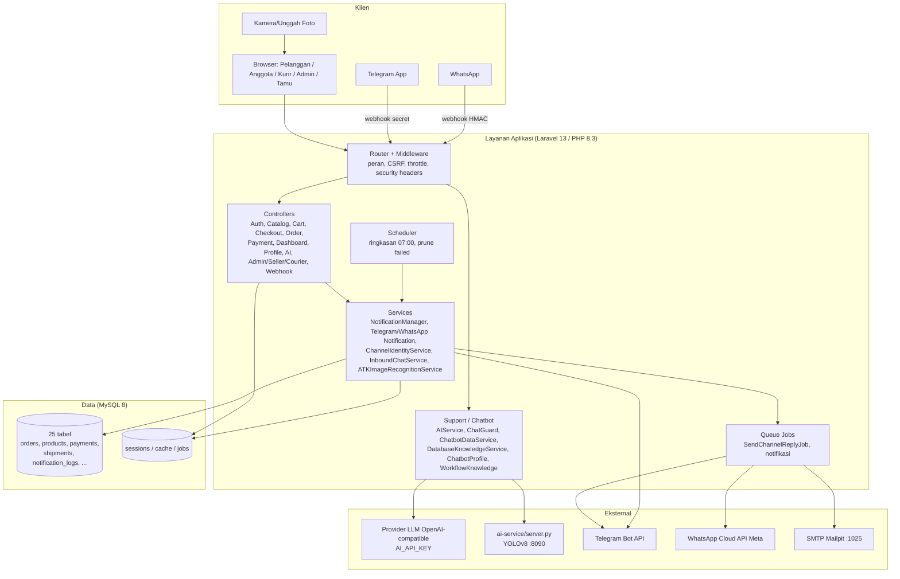

# SDD — SPESIFIKASI DESAIN ARSITEKTUR AGUNG ATK

**Versi:** 1.0 — 17 November 2026
**Cakupan:** arsitektur sistem, keterkaitan diagram↔kode, dan audit UI/UX + rancangan prototype.
**Diagram detail:** `docs/uml/use_case.md`, `activity.md`, `class_diagram.md`, `sequence_diagram.md`, `erd.md`.

---

## 1. Gambaran Umum Sistem

### Prinsip desain
1. **Satu sumber kebenaran:** semua angka dari database lewat Eloquent (chatbot tanpa SQL bebas).
2. **Otorisasi di server:** middleware peran menentukan akses; chatbot memakai role dari session.
3. **Pagaran berlapis pada AI:** guard input → lapisan data/perintah → LLM → guard output.
4. **Gagal aman:** layanan eksternal mati/tolak → fallback jujur, bukan crash (teruji).
5. **Asinkron untuk I/O eksternal:** notifikasi & balasan kanal lewat queue.

---

## 2. Keterkaitan Diagram ↔ Kode (traceability)

| Diagram | Sumber kode nyata | Tes pemvalidasi |
|---|---|---|
| Use case UC1–UC26 | `routes/web.php` (111 route), middleware `app/Http/Middleware/*` | `RoleAccessTest`, `AuthTest`, `AccountPagesTest` |
| Activity Login | `AuthController::login`, `redirectBasedOnRole`, `EnsureAccountIsActive` | `AuthTest` |
| Activity Checkout | `CheckoutController::store` (transaksi) | `CheckoutTest` |
| Activity Pencarian Gambar | `ATKImageRecognitionService`, `config/services.php image_search` | `ImageSearchTest`, `YoloImageSearchTest` |
| Activity Chatbot | `AIService::buildReply`, `ChatGuard`, `ChatbotDataService` | `ChatbotCommandsTest`, `ChatbotDataIntegrationTest`, `ChatbotIntelligenceTest` |
| Activity Notifikasi | `NotificationManager::dispatch`, `config/notifications.php` | `NotificationDispatchTest`, `NotificationSettingsTest` |
| Activity Tautan Kanal | `ChannelIdentityService`, `ProfileController` | `ChatbotChannelWebhookTest` |
| Class diagram §1 | `app/Models/*` (17 model) | `ModelRelationTest`, `RelationshipTest` |
| Class diagram §2 | `app/Services/*`, `app/Support/*`, `app/Jobs/*` | tes integrasi terkait |
| Sequence Login/Checkout | controller + model di atas | `AuthTest`, `CheckoutTest` |
| Sequence Chatbot AI | `AIService` + `ChatGuard` + `ChatbotDataService` | `Chatbot*Test` (8 file) |
| Sequence YOLO | `YoloDetectionService` → `ai-service/server.py` | `YoloImageSearchTest` (mock HTTP) |
| Sequence Notifikasi | `NotificationManager` → job → service kanal | `NotificationDispatchTest`, `WhatsAppCloudApiTest` |
| Sequence Webhook | `WebhookController` → `InboundChatService` → job | `ChatbotChannelWebhookTest` (30 tes) |
| ERD | `information_schema` MySQL (25 tabel) + migration | `ModelRelationTest`, `RelationshipTest` |

---

## 3. Keputusan Arsitektur Penting (Architecture Decision Records ringkas)

| ID | Keputusan | Alasan | Alternatif ditolak |
|---|---|---|---|
| AD1 | Chatbot memakai **intent → Eloquent** untuk data toko | Aman (read-only, scope role), cepat, angka selalu benar | Memberi LLM akses SQL bebas → risiko bocor & karangan |
| AD2 | **ChatGuard di luar model** | Pemeriksaan privasi/rahasia sebelum & sesudah model | Mengandalkan prompt saja → mudah dibobol |
| AD3 | **YOLOv8 layanan terpisah** (Python) | Inferensi berat tidak membebani PHP; dapat di-scale/restart independen | Menjalankan model di dalam request PHP → lambat & rapuh |
| AD4 | Notifikasi via **queue + dedupe + log** | Tahan gagal jaringan, dapat ditelusuri | Kirim sinkron → timeout memperlambat bisnis |
| AD5 | Webhook **fail-closed** (secret/HMAC wajib) | Mencegah pemalsuan pesan masuk | Mode longgar → risiko injeksi percakapan |
| AD6 | Tautan kanal berbasis **kode 6 digit kedaluwarsa + kunci akun** | Praktis tanpa meminta token di percakapan | Meminta pengguna mengirim token → jejak rahasia |

---

## 4. Audit UI/UX (terukur dari view aktual)

### 4.1 Konsistensi desain
- Dua layout utama: `layouts/app.blade.php` (publik) & `layouts/dashboard.blade.php` (berbasis role) — konsisten memakai Bootstrap 5.3.3 + Bootstrap Icons (CDN, lengkap dengan `integrity`), font Plus Jakarta Sans.
- Komponen kartu/alert/badge dipakai seragam di seluruh halaman admin.

### 4.2 Navigasi & pemisahan menu
- Sidebar dashboard dibangun per role; pengujian `RoleAccessTest` & `AccountPagesTest` memastikan pengguna tidak melihat menu halaman role lain.
- **Temuan:** terdapat route alias (`/kurir/dashboard` ≡ `/courier/dashboard`, dst.) — menu utama hanya memakai satu bentuk, tetapi alias perlu didokumentasikan agar tidak dianggap "menu ganda".

### 4.3 Responsif & mobile
- viewport tersedia pada **5 layout**; komponen Bootstrap grid + kelas responsif digunakan; tembel collapsible sidebar (`Buka menu navigasi`).
- ⚠️ Belum ada pengujian otomatis ukuran layar (hanya manual) — catatan perbaikan.

### 4.4 Hierarki visual
- Judul halaman → breadcrumb/kartu ringkasan → tabel/daftar → aksi; warna aksi utama konsisten (Bootstrap primary).

### 4.5 Form input, validasi & feedback
- **203** tempat menampilkan error field (`errors->first`/`@error`) dan **96** kelas `is-invalid` → validasi server-side tampil jelas per field.
- **29** alert sukses/gagal (`alert-success`/`alert-danger`) dari flash session.
- Contoh live: uji kirim notifikasi menampilkan *"Pesan uji berhasil terkirim melalui Email ke …"*.

### 4.6 Loading state
- ✅ Skrip global di `layouts/app.blade.php` & `layouts/dashboard.blade.php`: setiap submit form menonaktifkan tombol + spinner "Memproses…", opt-out `data-no-loading` untuk form AJAX (chat), pemulihan tombol pada `pageshow` (bfcache).

### 4.7 Light/Dark/System theme
- **67** referensi mode gelap; `partials/theme.blade.php` mengelola preferensi (Terang/Gelap/System) — teruji `ThemeTest`.

### 4.8 Aksesibilitas
- **79** atribut `aria-*` dan **17** `role=` tersebar di view (label tombol, `aria-expanded` menu, dsb).
- `<html lang="id">` pada kedua layout.
- ⚠️ Pemetaan keyboard & kontras warna belum diaudit menyeluruh — catatan perbaikan.

### 4.9 Halaman error & keadaan kosong
- 404/403/500 tersedia (`ErrorPagesTest`); daftar kosong menampilkan pesan penjelas.

### 4.10 Ringkasan audit UI/UX

| Aspek | Status | Bukti |
|---|---|---|
| Konsistensi desain | ✅ Baik | 2 layout, Bootstrap CDN ber-integrity |
| Navigasi per role | ✅ Baik | `RoleAccessTest` |
| Responsivitas | ⚠️ Cukup (manual) | viewport + grid; tanpa tes otomatis |
| Validasi & feedback | ✅ Sangat baik | 203 error field, 29 alert |
| Loading state | ⚠️ Kurang | hanya 4 spinner |
| Dark mode | ✅ Baik | 67 titik, teruji `ThemeTest` |
| Aksesibilitas | ⚠️ Cukup | 79 aria; audit menyeluruh belum |

---

## 5. Prototype Interaktif

Karena lingkungan tidak menyediakan integrasi Figma, disediakan **prototype HTML/CSS/JS interaktif mandiri**:

- **File:** `docs/prototype/index.html` (satu file, tanpa dependensi eksternal, dapat dibuka langsung di browser).
- **Cakupan:** alur utama 4 peran — Beranda + pencarian gambar, Katalog & keranjang, Checkout & pelacakan, Dashboard admin (produk/pesanan/laporan), Chatbot — dengan pemilih role, mode gelap, dan navigasi antar layar prototype.
- **Status:** prototype rancangan (bukan tangkapan layar aplikasi nyata); halaman nyata aplikasi tetap sumber kebenaran.

> Jika nantinya Figma tersedia, struktur layar pada prototype ini siap dipindahkan 1:1 (penamaan layar & komponen konsisten dengan view Blade).

---

## 6. Peta Layer Kode

| Layer | Lokasi | Tanggung jawab |
|---|---|---|
| Routing | `routes/web.php`, `routes/console.php` (scheduler) | 111 route + jadwal |
| Middleware | `app/Http/Middleware/` (6) | peran, status akun, header keamanan |
| Controller | `app/Http/Controllers/` (29) | HTTP, validasi, otorisasi |
| Service | `app/Services/` (Notifications, Channels) | notifikasi, kanal, tautan akun |
| Support | `app/Support/` (AIService, ChatGuard, dsb.) | chatbot, knowledge, pengenalan gambar |
| Job | `app/Jobs/SendChannelReplyJob` | balasan kanal asinkron |
| Model | `app/Models/` (17) | relasi & aturan data |
| View | `resources/views/` (66) | tampilan Bootstrap + tema |
| AI eksternal | `ai-service/` (Python, YOLOv8) | deteksi objek |
| Konfigurasi | `config/services.php`, `config/notifications.php`, `config/ai.php` | integrasi & saklar |
| Pengujian | `tests/Feature|Unit` (40 file, 620 tes) | jaring pengaman regresi |
