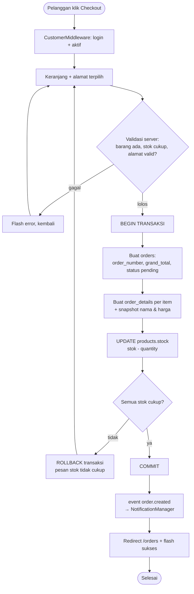
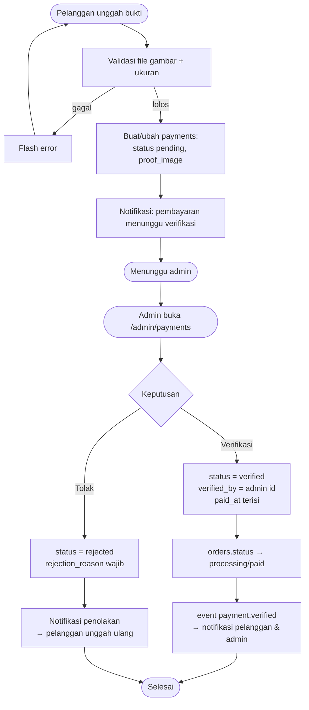
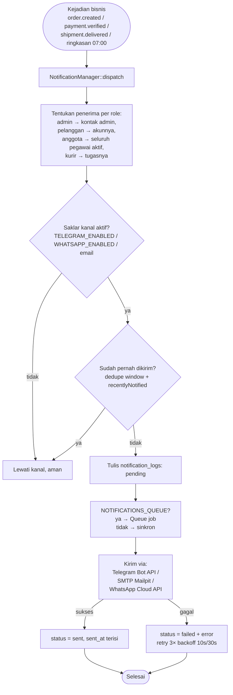
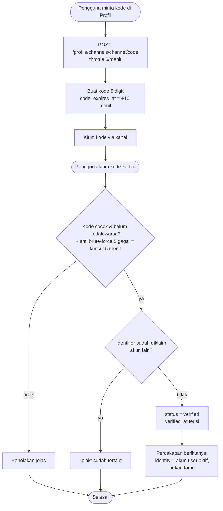

# ACTIVITY DIAGRAM — AGUNG ATK

Semua alur di bawah mengikuti kode aktual (controller/service disebut sebagai catatan).

---

## 1. Login & Deteksi Role

```mermaid
flowchart TD
    A([Mulai: pengguna buka /login]) --> B[Isi email + kata sandi]
    B --> C{Rate limit throttle:login<br/>5/menit per email+IP?}
    C -- lewat --> D[AuthController@login:<br/>verifikasi hash password]
    C -- melebihi --> E[Respons 429: terlalu banyak percobaan] --> Z([Selesai])
    D -- gagal --> F[Pesan: kredensial salah] --> B
    D -- berhasil --> G{is_active?}
    G -- false --> H[EnsureAccountIsActive:<br/>tolak + pesan akun nonaktif] --> Z
    G -- true --> I[redirectBasedOnRole]
    I --> J{role.name}
    J -- admin --> K[admin/dashboard]
    J -- anggota --> L[anggota/dashboard]
    J -- kurir --> M[kurir/dashboard]
    J -- pelanggan --> N[pelanggan/dashboard]
    K & L & M & N --> O[Catat sesi ke tabel sessions] --> Z([Selesai]))
```

---

## 2. Pengelolaan Produk (Admin/Anggota)

```mermaid
flowchart TD
    A([Mulai: buka /admin/products]) --> B{Middleware role?}
    B -- bukan admin/anggota --> X[403 Forbidden] --> Z([Selesai])
    B -- lolos --> C[Pilih aksi]
    C -->|Tambah| D[Form produk + gambar]
    C -->|Ubah| E[Form edit]
    C -->|Hapus/nonaktif| F[Set is_active = 0]
    D & E --> G[Validasi server-side:<br/>nama, slug unik, sku, harga > 0,<br/>stok >= 0, kategori ada]
    G -- gagal --> H[Kembali ke form + error per field] --> D
    G -- lolos --> I[Transaksi DB:<br/>simpan produk / product_images]
    I --> J[Tulis activity_logs<br/>(aktor, aksi, objek)]
    J --> K[Redirect + flash sukses] --> Z
    F --> J
```

---

## 3. Pencarian Produk — Teks & Gambar

```mermaid
flowchart TD
    A([Mulai]) --> B{Mode pencarian}
    B -- teks --> C[GET /products?q=...]
    C --> D[Eloquent: scopeActive + LIKE<br/>nama/brand/sku, limit halaman]
    D --> E[Tampilkan kartu produk] --> Z([Selesai])

    B -- gambar/kamera --> F[Unggah foto<br/>maks 2048 KB, tipe gambar]
    F --> G[ATKImageRecognitionService<br/>driver = hybrid]
    G --> H{Layanan YOLO hidup?<br/>POST /detect :8090}
    H -- ya --> I[YOLOv8 deteksi objek:<br/>kelas + confidence + margin]
    H -- timeout/gagal --> J[Fallback pengenalan bawaan<br/>fitur tetap berfungsi]
    I --> K{confidence >= 0.80<br/>dan margin cukup?}
    K -- tidak --> L[Hasil uncertain:<br/>tampilkan jujur tanpa mengarang] --> Z
    K -- ya --> J
    J --> M{Kelas cocok<br/>dengan produk katalog?}
    M -- bukan ATK --> N[Pesan baku:<br/>Barang Tidak Sesuai Kriteria Toko] --> Z
    M -- cocok & stock = 0 --> O[Pesan baku: Stok Kosong] --> Z
    M -- cocok & stok ada --> P[Tampilkan saran produk<br/>(nama, harga, stok, tautan)] --> Z
```

---

## 4. Chatbot AI (alur satu pesan)

```mermaid
flowchart TD
    A([Pesan masuk:<br/>widget /ai atau webhook kanal]) --> B[Simpan pesan user<br/>ai_messages]
    B --> C{Webhook kanal?}
    C -- ya --> D[Validasi secret/HMAC + dedupe update]
    D -- gagal --> E[HTTP 401/403 fail-closed] --> Z([Selesai])
    D -- lolos --> F[Identitas masuk:<br/>ChannelIdentityService]
    C -- tidak --> F
    F --> G[ChatGuard INPUT:<br/>pola privasi/rahasia/injeksi?]
    G -- cocok --> H[Respons tetap penolakan<br/>model TIDAK dipanggil] --> S
    G -- bersih --> I{Perintah slash /menu /stok<br/>/produk /pesanan /lacak?}
    I -- ya --> J[Dijawab lokal deterministik<br/>bahasa perintah] --> S
    I -- tidak --> K{Intent data read-only?<br/>ChatbotDataService}
    K -- ya --> L[Query Eloquent ber-scope role<br/>LIMIT/agregasi, tanpa SQL bebas]
    L --> M[Jawaban angka nyata] --> S
    K -- tidak --> N{API AI tersedia?<br/>AI_API_KEY valid}
    N -- ya --> O[Panggil LLM:<br/>system prompt (identitas, bahasa,<br/>peran, aturan data) + konteks JSON]
    N -- tidak/tidak valid --> P[Fallback lokal jujur:<br/>tak mengarang informasi] --> S
    O --> Q[ChatGuard OUTPUT:<br/>saring kebocoran sistem/rahasia]
    Q --> R[Sanitasi + simpan balasan] --> S
    P --> R
    S[Tampilkan balasan<br/>+ catat notification/log bila via kanal] --> Z
```

---

## 5. Pemesanan (Checkout)



---

## 6. Pembayaran & Verifikasi



---

## 7. Pemrosesan Pesanan → Penugasan Kurir → Pengiriman

```mermaid
flowchart TD
    A([Pesanan verified]) --> B[Anggota/Admin memproses:<br/>stok siap, pesanan disiapkan]
    B --> C[Admin membuka pesanan<br/>/admin/orders/id]
    C --> D{Kurir aktif tersedia?}
    D -- tidak --> E[Flash: belum ada kurir] --> C
    D -- ya --> F[Buat shipments:<br/>courier_id, tracking_number,<br/>status waiting]
    F --> G[orders.status → shipping<br/>+ notifikasi kurir & pelanggan]
    G --> H([Kurir login /courier/shipments]))
    H --> I[Hanya melihat shipment<br/>courier_id = dirinya]
    I --> J[Update status: shipped<br/>shipped_at terisi]
    J --> K[Sampai tujuan → delivered<br/>delivered_at + bukti serah]
    K --> L[orders.status → completed<br/>completed_at terisi]
    L --> M[event shipment.delivered<br/>→ notifikasi pelanggan & admin] --> Z([Selesai])
```

---

## 8. Notifikasi Otomatis (satu kejadian)



---

## 9. Tautan Akun Kanal (WA/TG → Akun Login)


