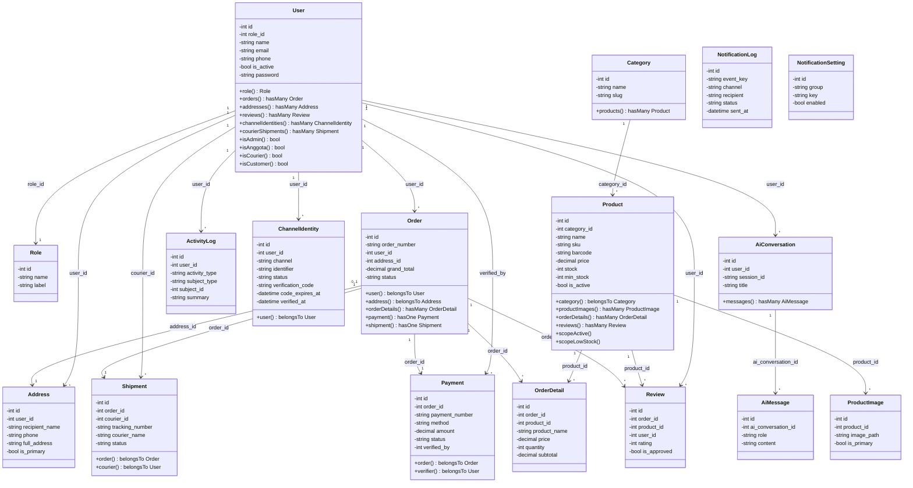
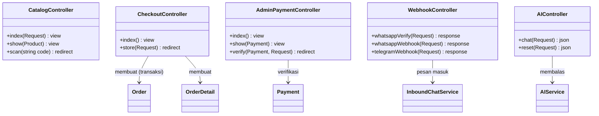

# CLASS DIAGRAM — AGUNG ATK

Disusun dari **struktur kode aktual** (bukan rancangan fiktif). Kelas yang tidak ada di implementasi tidak digambar.

---

## 1. Diagram Kelas Inti (Mermaid)

---

## 2. Lapisan Service & Support (kode aktual)

```mermaid
classDiagram
    class NotificationManager {
        +dispatch(string eventKey, array data)
        +sendTest(string channel, ?string message, ?string recipient) array
        +channelStatus(string channel) array
        +recipients(string eventKey, array data) array
        -channelEnabled(string channel) bool
        -missingWhatsApp() array
        -missingEmail() array
    }
    class TelegramNotificationService {
        +send(string chatId, string text) bool
        +getMe() array
        +setWebhook(string url) array
        +deleteWebhook() array
        +webhookInfo() array
    }
    class WhatsAppNotificationService {
        +sendText(string to, string text) bool
        +sendTemplate(string to) bool
        +verifySignature(string payload, string header) bool
    }
    class ChannelIdentityService {
        +requestCode(User user, string channel) string
        +claim(User user, string channel, string identifier, string code) bool
        +resolve(string channel, string identifier) ?ChannelIdentity
        -isLocked(string channel, string identifier) bool
    }
    class InboundChatService {
        +handle(string channel, string identifier, string text) string
    }
    class SendChannelReplyJob {
        -string channel
        -string identifier
        -string reply
        +handle() void
        #backoff() array
    }
    class AIService {
        +buildReply(string message, ?User user) string
        -commandReply(string, Collection, ?User) ?string
        -localReply(string, ?User, Collection) string
        -askApi(array messages) ?string
        -catalog() Collection
        -multilingualGreeting(string) ?string
    }
    class ChatGuard {
        +passesInput(string message) bool
        +sanitizeOutput(string reply) string
        -detectLeak(string) bool
    }
    class ChatbotDataService {
        +reply(string lower, ?User user) ?string
        -detect(string) ?string
        -orderLookupReply(string, ?User) string
        -trackingLookupReply(string, ?User) string
        -lowStockReply() string
    }
    class DatabaseKnowledgeService {
        +schemaForPrompt() string
        +tables() array
    }
    class ChatbotProfile {
        +isWhoAmIQuestion(string) bool
        +whoAmIReply(bool loggedIn, ?string role) string
        +isIdentityQuestion(string) bool
    }
    class ATKImageRecognitionService {
        +recognize(string path) array
        -viaYolo(string path) ?array
        -fallback(string path) array
    }
    class YoloDetectionService {
        +detect(string path) array
    }

    NotificationManager --> TelegramNotificationService : kanal
    NotificationManager --> WhatsAppNotificationService : kanal
    NotificationManager --> NotificationLog : mencatat
    InboundChatService --> ChannelIdentityService : identitas
    InboundChatService --> AIService : membalas
    SendChannelReplyJob --> TelegramNotificationService : kirim
    SendChannelReplyJob --> WhatsAppNotificationService : kirim
    AIService --> ChatGuard : pagaran input/output
    AIService --> ChatbotDataService : intent data
    AIService --> DatabaseKnowledgeService : konteks skema
    AIService --> ChatbotProfile : identitas
    ATKImageRecognitionService --> YoloDetectionService : hybrid
```

---

## 3. Contoh Controller (tipikal)

---

## 4. Catatan Penerapan SOLID (jujur)

| Prinsip | Penerapan | Catatan |
|---|---|---|
| **S**ingle Responsibility | `NotificationManager` (orkestrasi) terpisah dari `Telegram/WhatsApp*Service` (transport); `ChatGuard` (keamanan) terpisah dari `AIService` (logika jawaban); `ChannelIdentityService` (tautan) terpisah dari `InboundChatService` (percakapan) | ✅ Kuat |
| **O**pen/Closed | Menambah kanal notifikasi = menambah service + baris config (tidak mengubah inti dispatch); menambah intent chatbot = menambah pola di `ChatbotDataService` | ✅ Cukup kuat |
| **L**iskov Substitution | Kanal notifikasi mengikuti kontrak kirim & status seragam (`channelStatus`) | ✅ |
| **I**nterface Segregation | **Tidak ada interface kustom** — kontrak disepakati lewat pola kode & docblock | ⚠️ Jujur: belum ada `interface`; kandidat bila pengembangan: `NotifiableChannel`, `ChatHandler` |
| **D**ependency Inversion | Controller bergantung pada service via method aplikasi; `AIService` bergantung pada collaborator (guard, data, profile) yang dapat ditukar | ⚠️ Sebagian — beberapa keputusan di-hardcode pada `AIService::buildReply` |

**Kesimpulan:** penerapan SOLID **baik** pada lapisan service; perbaikan lanjutan yang wajar (tanpa refactor besar) adalah memperkenalkan interface pada batas kanal bila roadmap pengembangan membutuhkannya.
