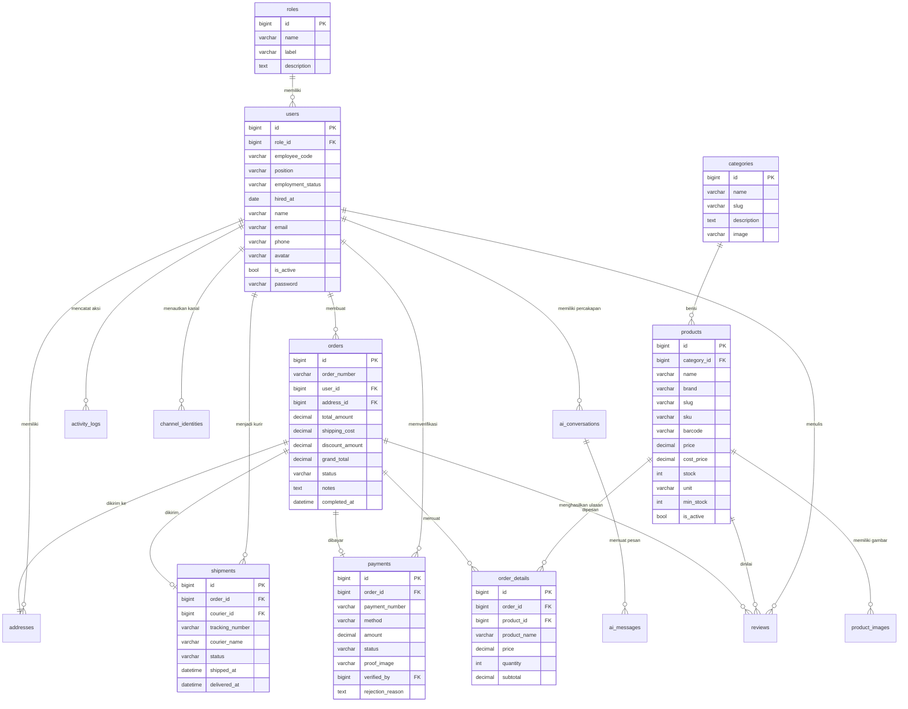
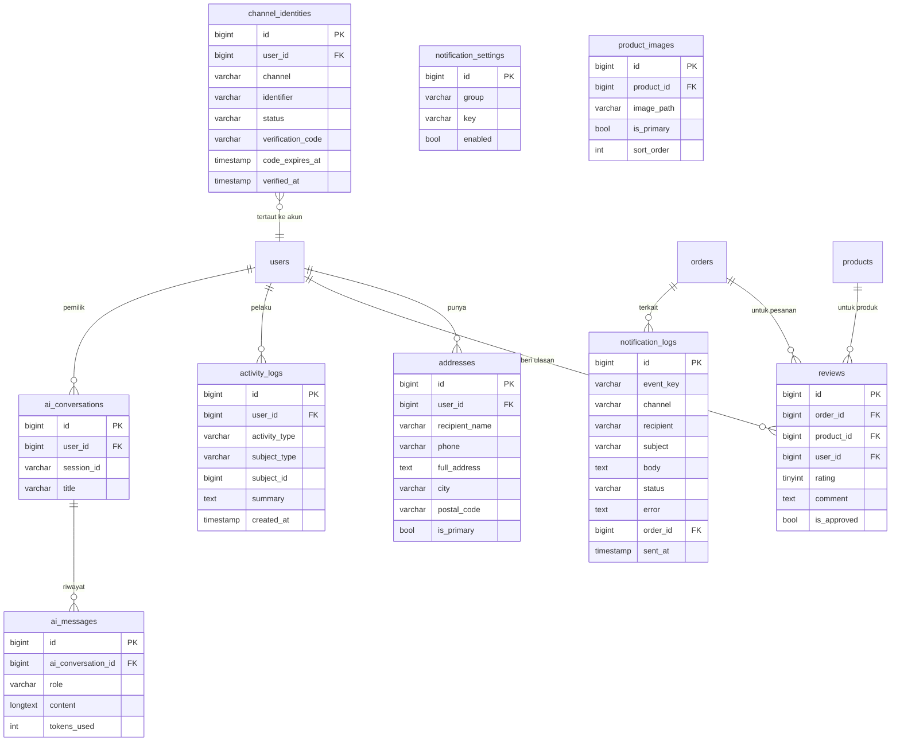

# ERD — AGUNG ATK

Sumber: struktur tabel **aktual MySQL** (`information_schema`, database `agung_atk`, 25 tabel) — konsisten dengan migration & model Laravel.
Legenda: **(PK)** primary key, **(FK)** foreign key, `?` = nullable.

---

## 1. ERD Inti Bisnis (Mermaid)

---

## 2. ERD Pendukung (audit, notifikasi, AI, kanal, ulasan, alamat)

---

## 3. Tabel Infrastruktur (bukan domain bisnis)

| Tabel | Peran |
|---|---|
| `migrations` | jejak migrasi |
| `sessions` | sesi login (driver database) |
| `cache`, `cache_locks` | cache aplikasi |
| `jobs`, `failed_jobs`, `job_batches` | antrean & retry notifikasi/balasan |
| `password_reset_tokens` | token reset (alur admin) |

---

## 4. Cardinality & Keterangan Relasi

| Relasi | Tipe | Keterangan |
|---|---|---|
| roles → users | 1 : N | 4 peran (admin, anggota, kurir, pelanggan) |
| users → orders | 1 : N | satu pembeli banyak pesanan |
| orders → order_details | 1 : N | baris item (snapshot `product_name`/`price`) |
| products → order_details | 1 : N | produk banyak dipesan → **junction many-to-many orders ↔ products** |
| orders → payments | 1 : 0..1 | 1 order minimal 1 bukti bayar (opsi verifikasi ulang) |
| orders → shipments | 1 : 0..1 | kirim internal (satu paket per pesanan) |
| users(courier) → shipments | 1 : N | satu kurir banyak tugas |
| orders → reviews | 1 : N | ulasan per item pesanan |
| users ↔ products (via reviews) | N : M | banyak pembeli menilai banyak produk |
| categories → products | 1 : N | klasifikasi ATK |
| products → product_images | 1 : N | satu gambar utama (`is_primary`) |
| users → channel_identities | 1 : N | tautan WA/TG (unik per `channel`+`identifier`) |
| users → ai_conversations → ai_messages | 1 : N : N | riwayat chat (tamu memakai `session_id` tanpa `user_id`) |
| users → activity_logs | 1 : N | jejak audit |
| orders → notification_logs | 1 : N | jejak notifikasi per kejadian |

**Konsistensi:** seluruh FK di atas tercatat pada migration `database/migrations/*` dan direlasikan di model Eloquent (terverifikasi lewat `ModelRelationTest`/`RelationshipTest`).
