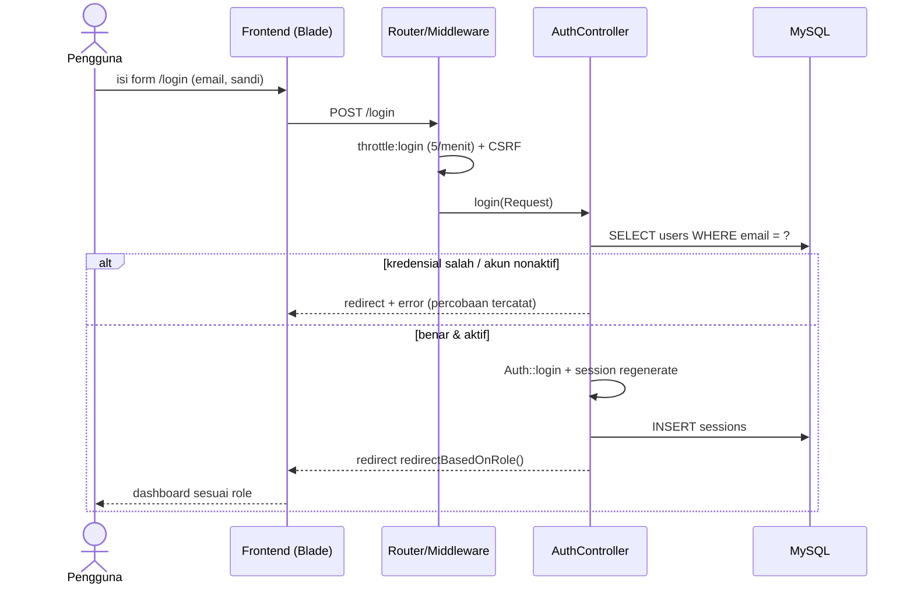
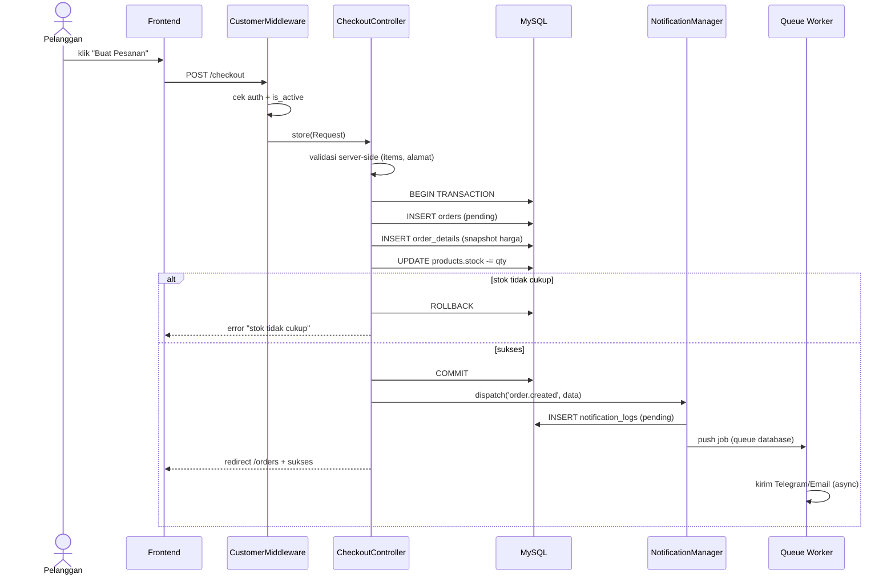
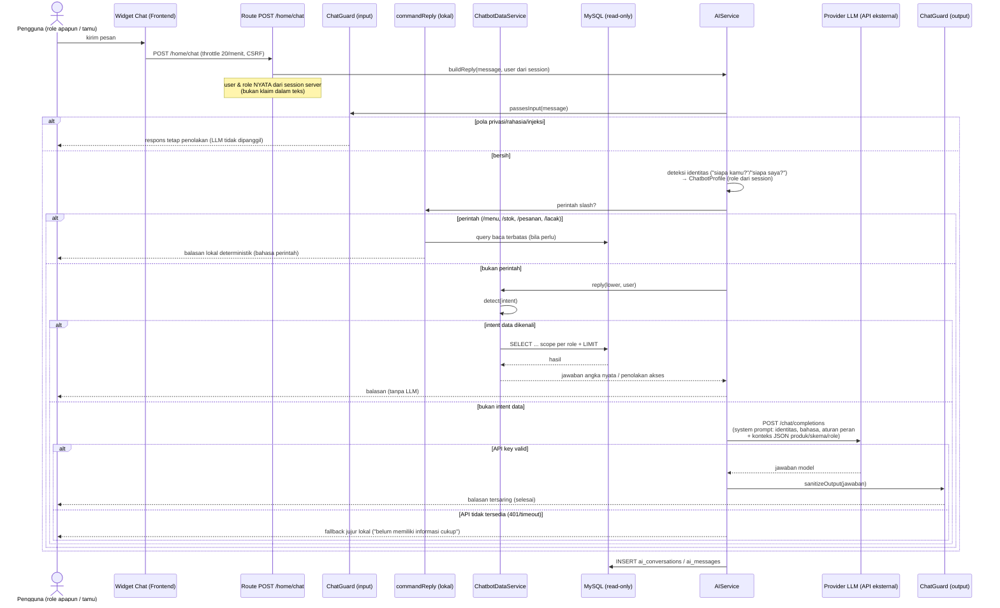
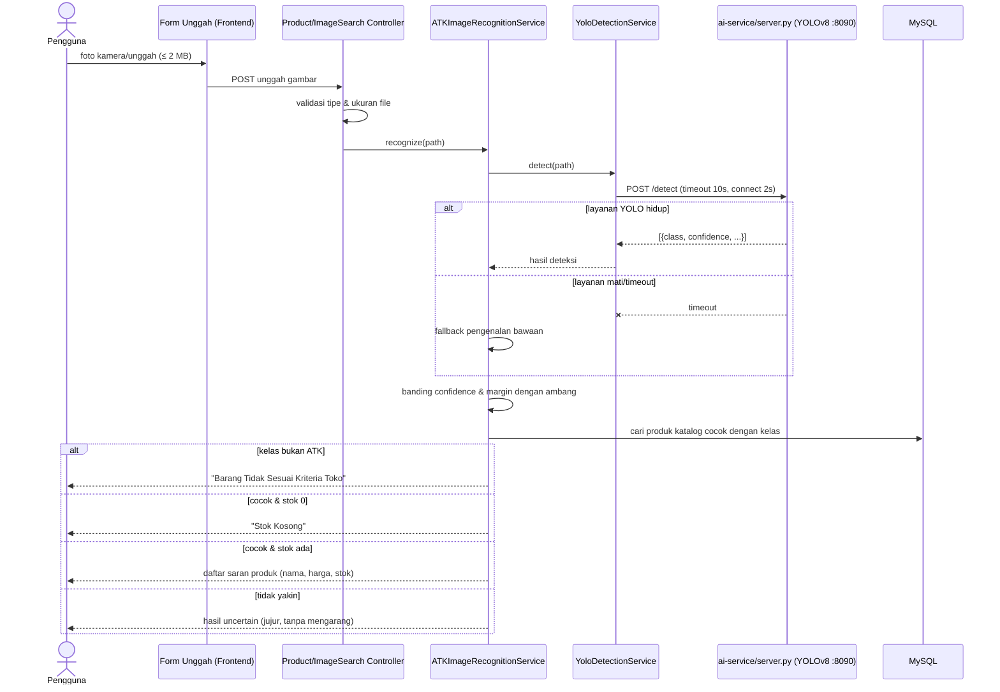
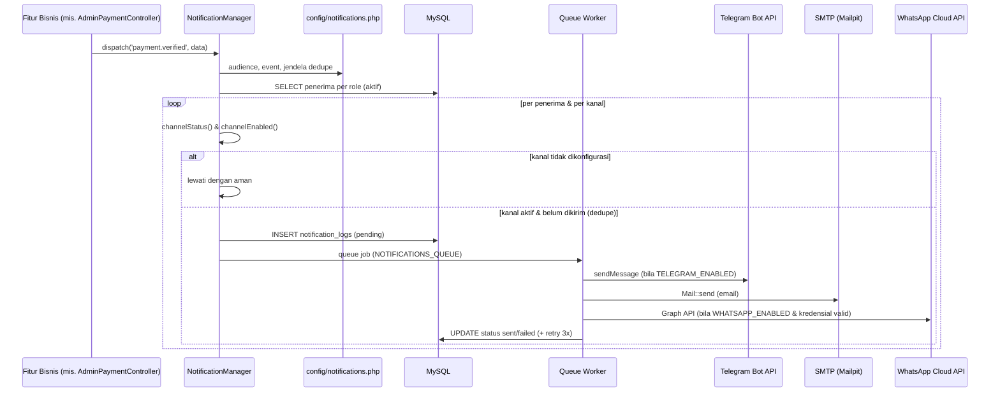
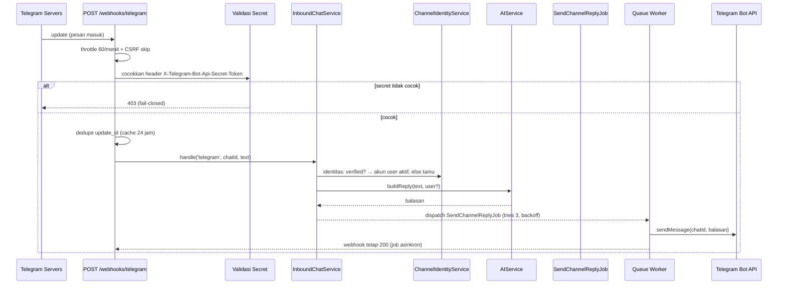

# SEQUENCE DIAGRAM — AGUNG ATK

---

## 1. Autentikasi & Deteksi Role

---

## 2. Checkout (Transaksi Konsisten)

---

## 3. Chatbot AI — Alur Lengkap (autentikasi → permission → data → AI → balasan)

**Titik kritis yang terlihat pada diagram:**
1. **Autentikasi** — `user` & role diambil dari session server.
2. **Permission** — scope query ditentukan role di `ChatbotDataService` (bukan dari teks pengguna).
3. **Data** — hanya intent terbatas, read-only, ber-LIMIT.
4. **AI processing** — system prompt + konteks; API eksternal diganti aman bila gagal.
5. **Balasan** — melewati pagaran output sebelum tampil.

---

## 4. Pencarian Produk via Gambar (YOLOv8)

---

## 5. Notifikasi Multi-Kanal (event → queue → kirim)

---

## 6. Webhook Telegram Masuk (balasan chatbot via kanal)

